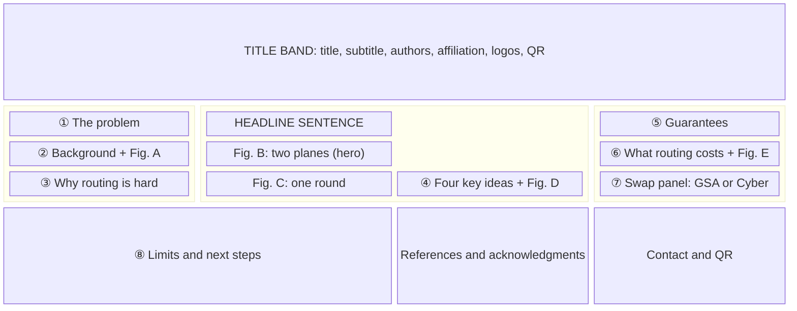
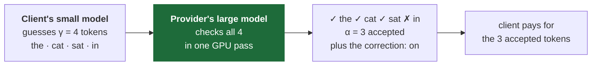
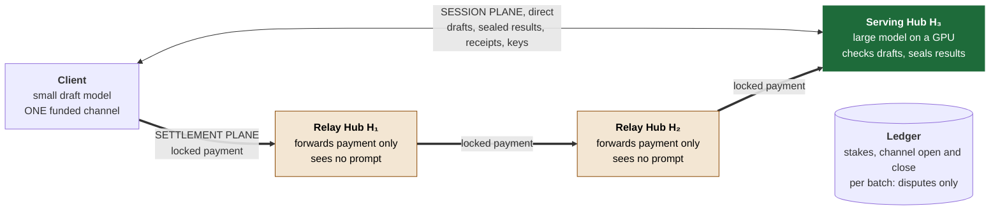
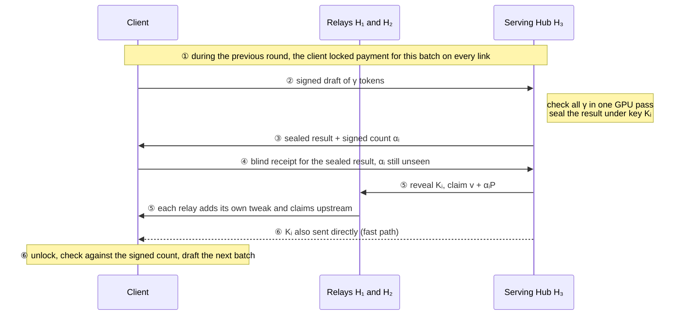
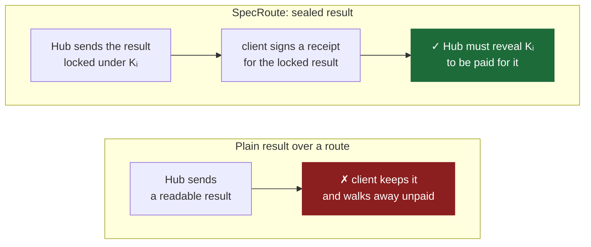
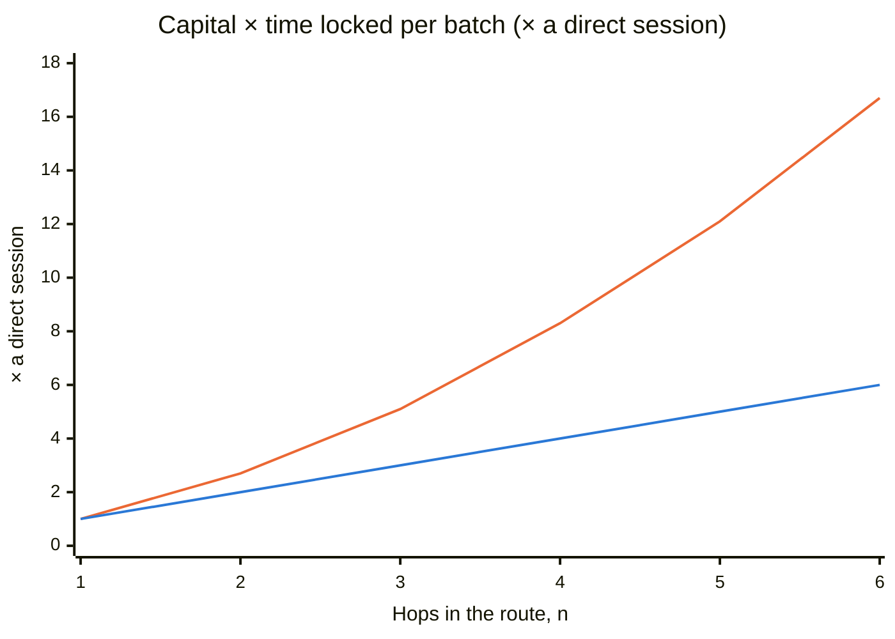
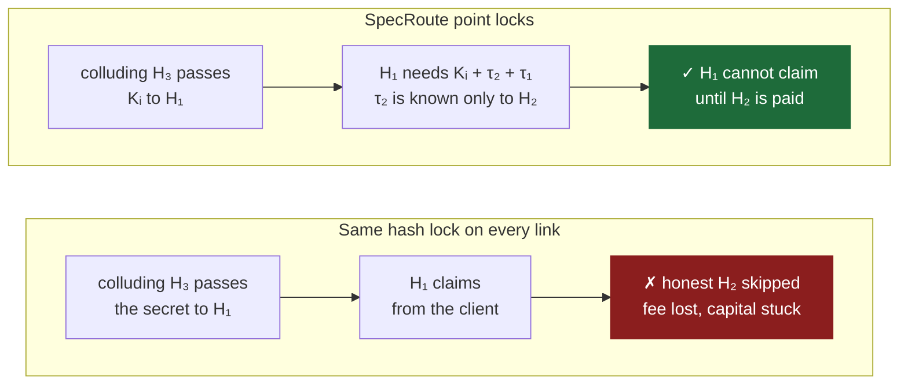

# SpecRoute Poster: Design for the GSA Symposium and the Cyber Conference

**What this file is.** The design for one research poster on SpecRoute, shown at two venues. It contains the poster's final text, its figures (as Mermaid), its layout, the talk tracks, and preparation for questions.

**Sources.** Every claim on the poster comes from one of three places: [specroute_paper_draft.md](specroute_paper_draft.md) §3, the cost model in [multihop_hub_routing_design.md](multihop_hub_routing_design.md) §7, or the measured results of the SPECIE paper. §8 maps each claim to its source.

**What the poster can claim.** The work so far is a protocol design and an analytical cost model. There are no simulator or prototype results for SpecRoute yet. The poster says this openly (panel ⑧) and labels every model number as a model number.

---

## 0 At a Glance

| | |
|---|---|
| **One message** | With one funded channel, a client can buy AI inference from any GPU provider. It pays per accepted token only once it can read the result, and no honest middleman can lose money. |
| **Audiences** | GSA: graduate students and faculty from every field, with judges likely outside security. Cyber conference: security researchers, practitioners and students. |
| **Strategy** | One poster. Panel ⑦ has two versions: plain language for GSA, threat model for the cyber conference. Everything else is shared. |
| **Format** | 48 × 36 in, landscape. This is an assumption; confirm it (§1.2). |
| **Figures** | Five on the shared poster (A–E) and one more in the cyber version of panel ⑦ (F). |
| **Text budget** | About 850 words of body text, not counting figure labels. |

---

## 1 Audiences

### 1.1 Who reads it, and what changes between venues

| | GSA symposium | Cyber conference |
|---|---|---|
| **Who stops** | Graduate students and faculty from every field. Judges are probably not security experts. | People who know encryption and blockchains, and some who know Lightning. |
| **What they should leave with** | The problem (paying strangers for AI), the trick (a locked box whose key is the payment), and that it is safe for every party. | The threat model, the attacks that are stopped, what is *not* stopped, and why Lightning-style routing fails here. |
| **Panel ⑦** | *In plain words*: the locked-box and escrow-chain analogy. | *Threat model and attacks*: attack table plus Figure F. |
| **Opening line** | 30-second plain pitch (§6.1). | 30-second technical pitch (§6.2). |
| **Terms on first use** | "GPU provider (serving Hub)", "middleman (relay Hub)". | "serving Hub", "relay", "outcome-priced lock", "point lock". |

**If you can print only once, print the cyber version.** A table has to be read, but an analogy can be spoken. At GSA, give the plain-language analogy as your opener (§6.1) and point at the attack table only if asked.

### 1.2 Venue details to confirm

| Item | GSA | Cyber conference |
|---|---|---|
| Date, abstract deadline, print deadline | TBD | TBD |
| Poster size and orientation | TBD (designed for 48 × 36 in landscape) | TBD |
| Judged? Criteria? | TBD | TBD |
| Mounting (board, easel, tri-fold) | TBD | TBD |
| Policy check for the papers behind the poster | SPECIE is under double-blind review, and SpecRoute targets a double-blind venue. Check that both calls for papers allow a public poster presentation. | Same |

**If the venue requires portrait (36 × 48 in):** keep the title band and the headline. Put the hero figure (B) under the headline at full width. Below it, use two columns: ①②③④ on the left and ⑤⑥⑦ on the right, with ⑧ and the footer at the bottom.

---

## 2 Message

### 2.1 Title

**Recommended:**

> **SpecRoute: Pay-per-Token AI from Any GPU, Through Middlemen You Don't Trust**
> *Routed payment channels for decentralized speculative LLM inference*

The main title tells a non-specialist what the work is for. The subtitle gives a specialist the technical category.

Alternatives:

- *SpecRoute: Routed Payment Channels for Decentralized Speculative LLM Inference.* This is the paper title. It is the safest choice at the cyber conference but opaque at GSA.
- *One Deposit, Any GPU: Trustless Pay-per-Token LLM Inference.*

### 2.2 Headline sentence

This sits in the centre column. It is the largest text on the poster after the title.

> **With one funded channel, a client can buy AI inference from any GPU provider in the network. It pays for each accepted token only once it holds the key to read the result, and no honest Hub that relays the payment can lose money or be cut out.**

### 2.3 Three takeaways

These are what a visitor should be able to repeat afterwards. Each one maps to a panel.

1. **Payment and delivery are one event.** The provider is paid for a result only by revealing the key that unlocks it (④, idea 1).
2. **Abuse costs what honest use costs.** Every GPU pass is paid for, even by a client that never confirms it received anything (④, idea 2).
3. **Routing's price is locked capital, not latency.** It grows linearly with hops for honest traffic and quadratically only when a Hub stalls, and it is bounded by ledger finality: seconds on a fast ledger (⑥).

---

## 3 Layout

**Grid (48 × 36 in, landscape).**

- Margins of 1 in at the sides and 0.75 in at the top and bottom, with 1 in gutters.
- Columns of 11 in | 22 in | 11 in.
- From top to bottom: a 6 in title band, about 23 in of body, and a 4 in footer band.

**Reading order.** The eye goes title → headline → hero figure (centre) → left column, top to bottom → bottom of the centre column → right column → footer. The circled numbers ①–⑧ mark this order for readers who want it.

**Wireframe.** This is a layout aid, not a figure for the poster. The centre column is twice the width of the side columns, and the headline and hero figure span all of it.

---

## 4 Panel Content

The text under each panel heading is the final poster text. Notes in *italics* are for you and do not go on the poster.

### Title band

- **SpecRoute: Pay-per-Token AI from Any GPU, Through Middlemen You Don't Trust**
- *Routed payment channels for decentralized speculative LLM inference*
- Md Omer Danish, [co-authors and advisor]
- Department of Computer Science and Engineering, University of Nevada, Reno · UNRcyberLab
- mdanish@unr.edu
- On the left: the UNR and UNRcyberLab logos. On the right: a QR code linking to [target to decide: lab page or preprint].

### ① The Problem *(about 85 words)*

**Anyone with a spare GPU can sell AI inference.** Clients pay through off-chain *payment channels*. They deposit once on a blockchain, then exchange signed micropayments directly, with no billing company in between.

**But a channel joins exactly two parties.** To use another provider (a different model, a free slot, a closer server), a client must open a new channel. That takes two blockchain transactions and a locked deposit. For short sessions, this fixed cost outweighs the inference itself.

**Goal:** reach *any* provider over channels that already exist, without trusting anyone in between.

### ② Background *(about 75 words, plus Figure A)*

**Speculative decoding.** The client's small model guesses the next γ tokens. The provider's large model checks all of them in one GPU pass and accepts the correct prefix: α of the γ tokens.

**SPECIE, our prior work,** turns each check into a unit of payment over a two-party channel. The client pays a price P per accepted token. Measured on a real GPU and a live blockchain, payment adds well under 1 ms per round.

**Figure A: Speculative decoding.** The provider's check is a record of the work it did, and that record is what the client pays for.

### ③ Why Routing Is Hard *(about 95 words)*

Three obvious designs fail:

- ✗ **A channel to every provider.** Each new provider costs two ledger transactions and a deposit. This is the cost we set out to remove.
- ✗ **Lightning-style routed payments (HTLCs).** These fix the amount *before* it is locked, but α is known only *after* the GPU check. Locking the maximum and refunding the rest costs a second routed payment in every batch. Also, a hash preimage proves payment, not delivery.
- ✗ **Forward SPECIE's plain result.** Once sessions are free to open, a client can take one result per session, never pay, and repeat. In speculative decoding, the result *is* the service.

### Centre: headline and hero figure

*The headline sentence (§2.2) goes here, above Figure B.*

**Figure B: Two planes over one route.** Drafts and results travel directly between the client and the serving Hub. Only locked payments travel along the route. Relays see no prompt and add no latency to inference, and the ledger is involved in a batch only if there is a dispute.

### Centre, lower left: one round

**Figure C: One round.**

- ① The locks for this batch were placed while the client was drafting the previous one.
- ② The client sends a signed draft.
- ③ The GPU checks the draft and returns the result sealed under a key Kᵢ, together with a signed count αᵢ.
- ④ The client acknowledges the sealed result without being able to read it.
- ⑤ The serving Hub reveals Kᵢ to claim its payment, and each relay claims from the hop before it.
- ⑥ The client unlocks the result and drafts on.

**If no receipt arrives within Δt,** the GPU frees the session's memory and collects only the request price v.

### ④ Four Key Ideas *(about 170 words, plus Figure D)*

1. **A sealed result whose key is the payment secret.** The serving Hub encrypts the result under a fresh key Kᵢ, and every lock on the route opens only with a secret that yields Kᵢ. The client commits before it can read anything, and the Hub cannot be paid for the result without delivering the key.
2. **Outcome-priced locks.** Each lock pays a public formula of the signed count α, so every hop computes the same amount and no refund travels back. A lock has two claim modes, and only one is ever used. *Deliver* pays v + αP (plus relay fees). *Request* pays only v, the cost of one GPU pass and the memory it holds, against the signed draft alone. Every draft is paid for.
3. **Relay-bound point locks.** Each relay's lock secret is the next relay's secret plus a private tweak that only this relay knows. Colluding Hubs cannot skip an honest relay and take its fee.
4. **Pipelining and lease-coupled unwinding.** The next batch's locks travel while the client drafts, so a round has the same four direct messages as a direct session, as long as the payment path is faster than drafting. When the GPU evicts a session, every lock on the route clears at once.

**Figure D: Sealing the result turns payment and delivery into one event.** The client has nothing to take before it commits, and the Hub has no way to be paid for the result that does not hand over the key.

### ⑤ Guarantees *(about 85 words)*

| Protects | Guarantee | Enforced by |
|---|---|---|
| Client | Pays per accepted token only once it can unlock the result. Loses at most one request price per unanswered draft. | Cryptography and ledger |
| Relay Hub | Never loses money: every payment it forwards is matched by one it can collect. | Cryptography and ledger deadlines |
| Serving Hub | Is paid at least the request price for every verification it performs. | Cryptography and ledger |
| Everyone | Abuse costs at least as much as honest use. | Pricing |
| Client | No added latency per round, as long as payments outpace drafting. | Pipelining |

*Assumptions:* unforgeable signatures, a hard discrete-log problem, a ledger that includes any transaction within a known time bound, and each party (or a watchtower) checking the ledger once per deadline gap. Any set of clients and Hubs may be malicious.

### ⑥ What Routing Costs *(about 70 words, plus Figure E and a table)*

**Routing costs locked capital, not latency.** Every relay locks its own capital for each batch in flight.

- **Honest traffic:** locked capital grows linearly with hops, to about n times a direct session.
- **A stalling Hub:** locked capital grows quadratically. The constant is set by ledger finality, not by network speed. A non-paying client cannot cause this, because its locks clear within Δt or the idle deadline.

**Figure E: Locked capital against path length, from the model.** The upper (orange) curve is a stalling Hub; it grows quadratically. The lower (blue) curve is honest traffic; it grows linearly. Each link's deadline sits one gap above the next link's, so a stall pins link k for about n − k gaps. Summed over the route, that is quadratic.

*Mermaid's line chart has no legend, so the caption must name both lines, by position as well as colour. Keep the words "upper" and "lower" on the poster. The two colours pass the colourblind-separation validator (protan ΔE 24.7).*

**Worst-case lock time on the client's first link:**

| Hops n | Fast-finality ledger (2 s) | Ethereum-L1-like ledger (≈ 13 min) |
|---|---|---|
| 1 | 3.5 s | ≈ 13 min |
| 3 | 8.5 s | ≈ 39 min |
| 5 | 13.5 s | ≈ 65 min |

*These come from the analytical model with assumed parameters: 0.5 s rounds, pipeline depth 1, Δt = 0.5 s, and a per-hop deadline gap of 2.5 s (fast ledger) or 781 s (slow ledger). Calibration on the prototype is next.*

*Formulas, from multihop_hub_routing_design.md §7.3:*

- *Stall amplification: A(n) = n + δ·n(n−1) / (2(E_pipe + M_n)), with δ = 2.5 s and E_pipe + M_n = 3.5 s.*
- *First-link lock: E_pipe + M_n + (n−1)δ.*

*If calibrated values arrive, recompute both the chart and the table from these formulas.*

### ⑦ Swap Panel

#### GSA version: In Plain Words *(about 90 words)*

**A locked box.** The GPU provider hands over its answer in a locked box. The only way it can be paid for the answer is to give out the key.

**A chain of escrow agents.** Your payment passes through middlemen. Each one is repaid by the one before it, using the key plus a private number that only that middleman holds. None of them can be skipped or left out of pocket.

**A fair fee for walking away.** If you never confirm that you received the box, the provider frees its memory and charges only for the work it did.

#### Cyber version: Threat Model and Attacks *(about 110 words, plus Figure F)*

**Adversary:** any set of clients and Hubs, deviating arbitrarily. The ledger is honest. Peer messages may be delayed arbitrarily, which affects liveness only.

| Attack | By | Stopped by | Worst case |
|---|---|---|---|
| Take the result, never pay | Client | Sealed result and request price | Client pays v |
| Take payment, withhold the result | Serving Hub | Key = lock secret | No payment without the key |
| Attest an α that does not match the sealed result | Serving Hub | Signed attestation | Fraud proof, stake slashed |
| Skip an honest relay and take its fee (wormhole) | Colluding Hubs | Point locks with private tweaks | Cannot claim without the skipped relay's tweak |
| Exhaust GPU memory with free sessions | Client | Request price on every draft | Paid at the honest price |
| Lock relay capital without paying | Client | Lease-coupled unwinding | Cleared within Δt or the idle deadline |
| Stall to freeze route capital | Any Hub | Deadline ladder | Bounded, not prevented (⑥) |

**Figure F: The wormhole attack, with and without tweaks.**

### ⑧ Limits and Next Steps *(footer, about 80 words)*

**Not provided.**

- Proof that the model computed correctly. A wrong but self-consistent result is deterred economically, as in SPECIE. A proof of inference would plug in unchanged.
- Route privacy. Relays learn each batch's α and can link a route's hops.
- Prevention of stalling. A stalling Hub is bounded, not prevented.

**Status:** protocol design and analytical cost model. **Next:** formal security proofs; a simulator for collateral, latency and jamming; and a 3-hop prototype on a live blockchain.

### Footer: references and acknowledgments

1. SPECIE: Trustless Payment Channels for Decentralized Speculative LLM Inference Economies. Under review, 2026. *(See the policy check in §1.2.)*
2. Y. Leviathan, M. Kalman, Y. Matias. Fast Inference from Transformers via Speculative Decoding. ICML 2023.
3. J. Poon, T. Dryja. The Bitcoin Lightning Network: Scalable Off-Chain Instant Payments. 2016.
4. G. Malavolta, P. Moreno-Sanchez, C. Schneidewind, A. Kate, M. Maffei. Anonymous Multi-Hop Locks for Blockchain Scalability and Interoperability. NDSS 2019. *(This is the source of the wormhole attack and of point-based locks.)*

Acknowledgments: [advisor, lab, funding].

---

## 5 Visual Design

**Colour.** Each colour has one meaning, and these match the paper figures.

| Role | Colour | Where |
|---|---|---|
| Serving Hub, good outcome | green `#1e6b3a`, white text | Figures A, B, D, F |
| Relay Hub | tan fill `#f3e6d3`, border `#8a4700` | Figure B |
| Attack, failure, gap | red `#8b1e1e`, white text | ③ ✗ marks, Figures D and F |
| Chart series | orange `#eb6834` (stall), blue `#2a78d6` (honest) | Figure E only |
| Text | near-black `#1a1a19` on white | Everywhere |

- **Never use colour alone for good and bad.** Red and green always appear with ✓ or ✗ and a word, because red–green colour blindness affects about 1 in 12 men.
- **Proof it in greyscale.** On a greyscale print, every red or green item should still read correctly from its symbol and words.

**Type at 48 × 36 in.** Use one sans-serif family throughout (for example Source Sans 3, Inter, or Helvetica).

| Element | Size |
|---|---|
| Title | 100–120 pt, bold |
| Headline sentence | 66–72 pt |
| Panel headings | 48 pt |
| Body text | 30–32 pt |
| Figure labels | 24 pt or more |
| Captions and references | 22–24 pt |

**Symbols.** Use only γ, α, P, v, Kᵢ, Δt and n in the shared panels. τ appears only in Figure F, which is in the cyber version.

**Figures.** The Mermaid blocks in this file are the single source for every figure. When you assemble the poster, export each one at poster scale and check that every label is still at least 24 pt. Do not add nodes; a poster figure that needs more nodes should be a separate backup figure.

**Space.** Leave 1 in gutters, and don't fill any panel more than about 70%. Empty space is what makes the headline and the hero figure stand out.

---

## 6 Talk Tracks

### 6.1 Thirty seconds, GSA

> "Lots of people have spare GPUs and could sell AI answers, and your laptop can already run a small AI model. In our earlier work, SPECIE, your laptop guesses the next few words, a big model on someone's GPU checks the guesses, and you pay per correct guess, with no company in between. The catch is that you can only pay providers you have set up a payment channel with on a blockchain. SpecRoute lets you pay *any* provider by passing the payment through others. The trick is that the answer arrives in a locked box, and the key to the box *is* the payment. Nobody can be paid for an answer without delivering it, and the middlemen can't be cheated."

### 6.2 Thirty seconds, cyber conference

> "SPECIE, our prior work, does pay-per-token LLM inference over a bilateral payment channel using speculative decoding; the server's verification result is the unit of payment. SpecRoute routes those payments over Hub-to-Hub channels. Lightning-style routing breaks here for three reasons. The amount is known only after verification. The goods are information, so fair exchange is hard. And free sessions remove the deposit that stopped free-riding. We seal the outcome under a key that is also the lock secret. Each lock's amount is a public function of the signed outcome, with a request-price fallback. And per-relay tweaked point locks stop wormholes. The cost is collateral: linear in hops, and quadratic only under a stalling Hub."

### 6.3 Two-minute walk-through

Point at each panel as you go.

| Time | Point at | Say |
|---|---|---|
| 0:00–0:20 | Headline, Figure B | One channel, any GPU. Payments go along the route, and inference goes direct. |
| 0:20–0:40 | ②, ③ | What speculative decoding is, and the three ways naive routing breaks. |
| 0:40–1:20 | Figure C, ④ | The locked box, outcome-priced locks, the private tweaks, and pipelining. |
| 1:20–1:45 | ⑤, ⑥ | Who is protected, and what routing costs: capital, not latency. |
| 1:45–2:00 | ⑧ | What it does not do, and what comes next. Then invite questions. |

**Backup figures for deep questions.** Keep these on a tablet: paper draft Figure 6(a) (claim predicate), Figure 8(b) (lease state machine) and Figure 9(a) (why a relay never loses money).

---

## 7 Questions to Expect

**Why not just use Lightning?**
Lightning locks a fixed amount, but here the amount is known only after the GPU has checked the draft. Locking the maximum and refunding the rest costs a second routed payment in every batch. Also, a hash preimage proves that payment happened, not that the client received the result.

**What if the GPU returns garbage?**
SpecRoute guarantees that you pay exactly for the outcome the Hub signed, and only once you can decrypt it. If the decrypted result does not match the signature, that is a fraud proof, and the Hub's stake is slashed. A result that is wrong but self-consistent is deterred economically, as in SPECIE, where a server that substitutes a cheaper model earned 4.5× less than an honest one. A proof of inference would close this gap, and it is orthogonal to routing.

**Can the middlemen read my prompt?**
No. Drafts and results go directly between you and the serving Hub. Relays see only payments. They do learn how many tokens were accepted in each batch, and the poster states that leak (⑧).

**Doesn't routing slow every token down?**
No. The locks for the next batch travel while you are still drafting, so a round has the same four direct messages as a direct session. This holds as long as the payment path is faster than drafting. That is expected on datacenter links, and the simulator will measure where it stops holding.

**What stops someone from opening thousands of free sessions to hog GPU memory?**
Every draft must be backed by a lock that pays at least the request price. That price covers one GPU pass and the memory the session holds until its next batch is due. A session that sends no further draft by then is evicted.

**What if a middleman disappears mid-payment?**
Its neighbour settles on the ledger before the deadline. The deadlines are spaced so that an honest relay that has paid downstream always has enough ledger time to collect upstream.

**Why would a client sign a receipt for something it cannot read?**
The receipt and the Hub's signed count both bind the same ciphertext hash. If the unsealed result does not match the count, the client holds a fraud proof. In SPECIE, inspecting the result before paying could only check its form anyway, because the client does not run the large model.

**Aren't point locks already known?**
Yes. They come from the multi-hop locks literature (reference 4). What is new is binding them to outcome-priced amounts, sealed delivery and lease-driven unwinding. We use them to bind each relay to its claim, not for route privacy.

**Which blockchain?**
Any smart-contract ledger that includes transactions within a known time bound. The prototype uses a fast-finality ledger, where the worst-case lock is seconds. On a ledger with Ethereum-L1-like finality the worst case is about an hour (⑥), which is why the design targets fast finality.

**Is it built?**
Not yet. The protocol design and the cost model are done. A simulator and a 3-hop prototype, built on the SPECIE codebase, are next.

**Who opens the Hub-to-Hub channels?**
Hubs earn relay fees on capital that would otherwise sit idle. We assume that incentive; we do not design a mechanism for it.

---

## 8 Claims Audit

Every number or guarantee on the poster, where it comes from, and what kind of claim it is.

| Claim on the poster | Source | Kind |
|---|---|---|
| A new channel costs two ledger transactions and a deposit, which dominates short sessions | Paper draft §3.3, strawman 1 | Design argument |
| Payment adds well under 1 ms per round | SPECIE abstract | Measured (prior work) |
| A server that substitutes a cheaper model earns 4.5× less (Q&A only) | SPECIE abstract | Measured (prior work) |
| Relays see no prompt and add no latency to inference | Paper draft §3.1, two planes | Design property |
| Pays per accepted token only once it can unlock the result | Paper draft §3.2, G1 | Design property; proof pending |
| An honest relay never loses money | Paper draft §3.2 G2, Figure 9(a) | Design property; proof pending; assumes ledger monitoring |
| At most one request price per unanswered draft | Paper draft §3.2, G3 | Design property; proof pending |
| Abuse costs at least as much as honest use | Paper draft §3.2, G4 | Design property; proof pending |
| No added latency per round | Paper draft §3.2 G5, Figure 8(a) | Conditional on the payment path being faster than drafting; to be measured |
| Linear growth when honest, quadratic under a stall | Design doc §7.3 | Analytical model |
| 3.5 / 8.5 / 13.5 s and ≈ 13 / 39 / 65 min | Design doc §7.4 parameters, recomputed | Model with assumed parameters |
| Figure E values (1, 2.7, 5.1, 8.3, 12.1, 16.7) | Design doc §7.3 formula, δ = 2.5 s, E_pipe + M_n = 3.5 s | Model with assumed parameters |
| Relays learn α and can link hops; stalls bounded, not prevented | Paper draft §3.6 | Stated limitation |

---

## 9 Before Printing

- [ ] Confirm the size, orientation and deadlines for both venues (§1.2). Reflow for portrait if required.
- [ ] Check that the anonymity policies for SPECIE (under review) and SpecRoute (target venue) allow a public poster. If they don't, cite SPECIE only as "prior work, under review".
- [ ] Fill in co-authors, advisor, acknowledgments, funding, and the QR target.
- [ ] Check every number against §8. Every model number must be labelled as a model number on the poster itself.
- [ ] Print a 1/3-scale proof (16 × 12 in, which fits tabloid) and read it from 0.6 m; that matches reading the full poster from about 2 m. Then print the same proof in greyscale and check every ✓ and ✗.
- [ ] Bring: a tablet with the backup figures (§6.3), and cards or handouts with the QR code and email address.
