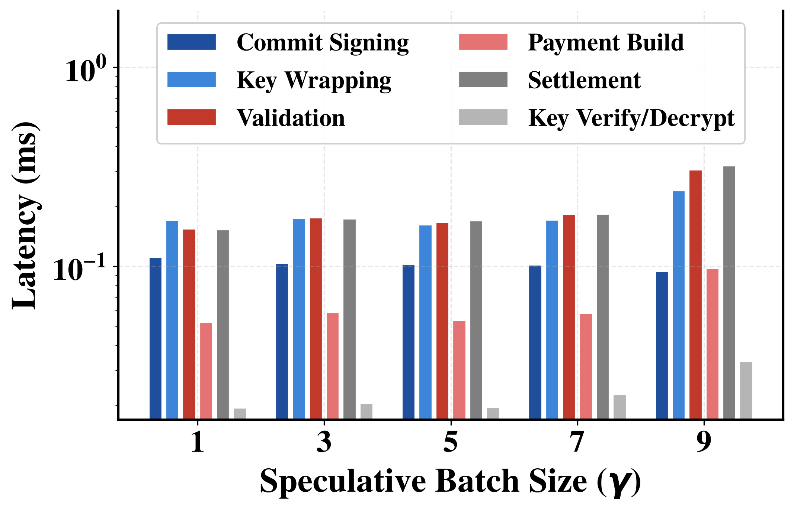
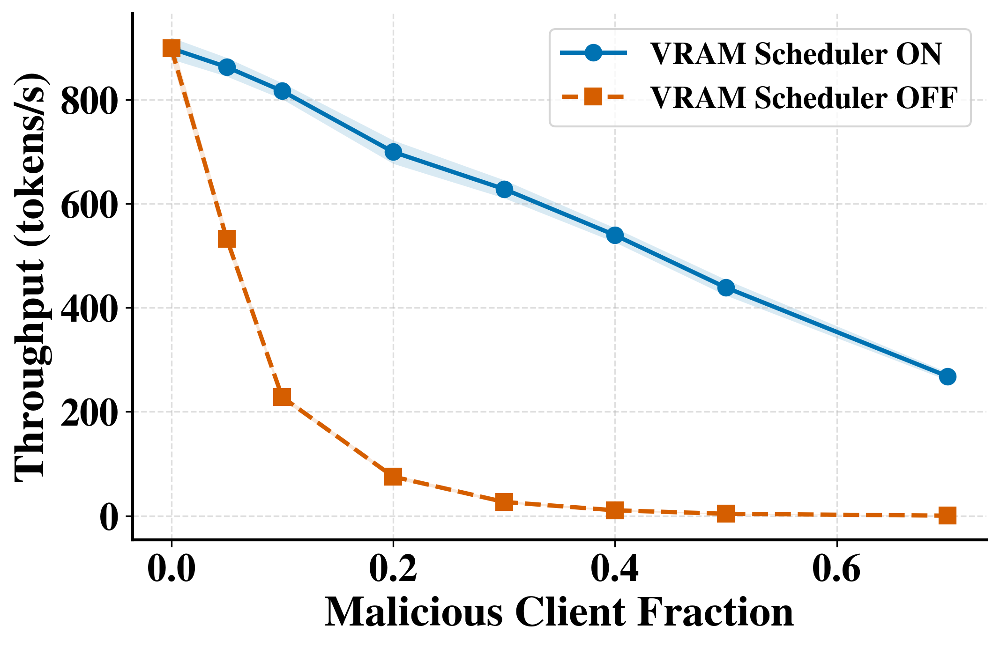
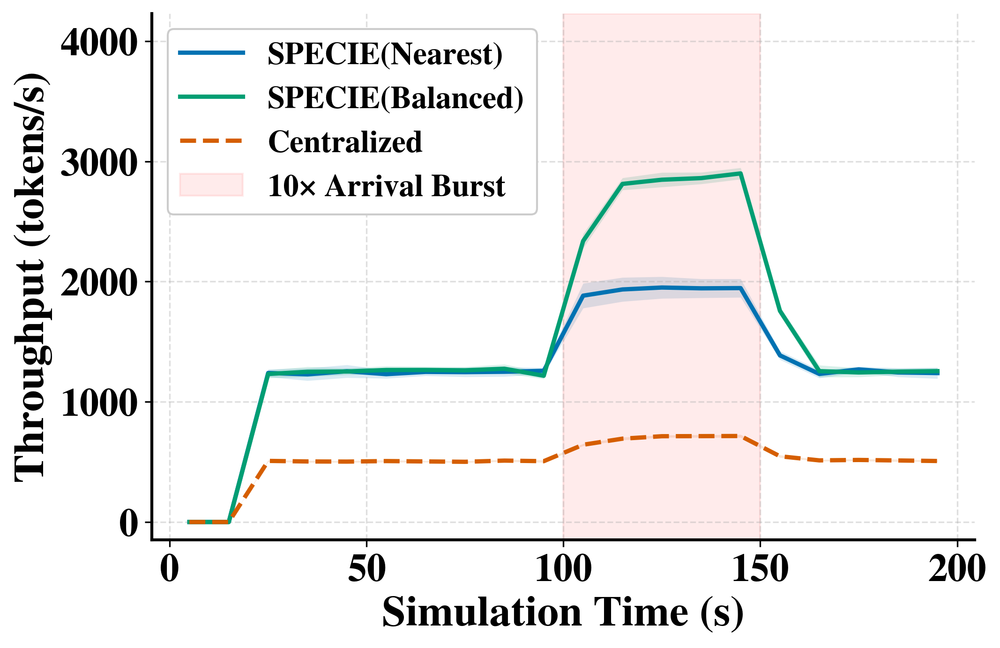
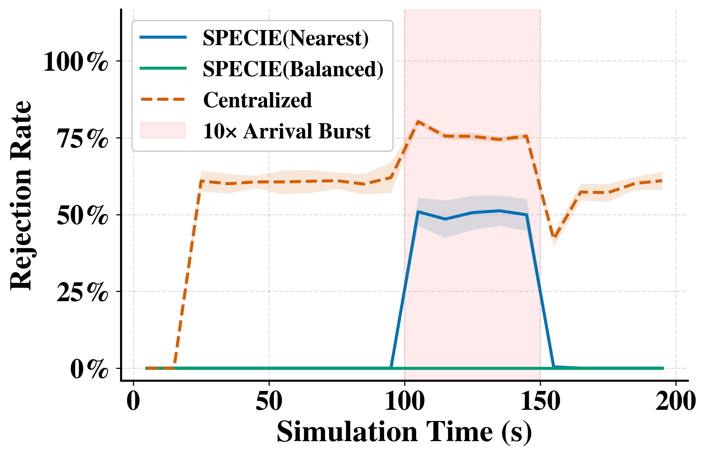

# Prototype Figures — Explained

This document explains every figure currently in this folder: which menu
option makes it, what actually happens on the real system while it's being
made, and how to read the picture once it's done. Written for a first read
with no assumed background — technical terms are defined the first time they
show up.

Right now this covers the **8 latency figures** (menu section "1) Performance
(latency)"), the **2 payment-channel overhead figures** (section 3), the
**2 economic correctness figures** (section 4), and the **6 simulation
figures** of menu section "10) Scalability & adversarial resilience" (those
live in `simulation_figures/`, not this folder — see their own intro below).
More sections will be added here the same way as you ask for them.

---

## ✓ 2026-07-27/28 fix log — read before trusting any timing/acceptance number below

Two real bugs in the live protocol code were found and fixed, both in
`prototype/src/hub/inference.py`'s `verify_batch()` (full detail:
`simulation/docs/evaluation_summary.md` §6.7, "Fix A"):

1. **Verification cost was linear in γ, not flat.** The hub used to
   *generate* γ+5 tokens autoregressively to check the draft, instead of
   scoring the draft in one forward pass — so `t_verify` scaled with γ
   (180→362ms across γ=1→10) instead of staying flat. Fixed: verification
   is now one forward pass reading the target's own per-position argmax,
   flat at ~90-140ms regardless of γ.
2. **Acceptance rate was capped by a word/token index-mismatch bug**,
   silently force-rejecting past the shorter of two differently-typed
   lists. Fixed: acceptance is now computed on real token IDs.

**Every figure below that reports `t_verify`, TPOT, round latency, or
acceptance rate/alpha at γ>1 was affected**: that's 1.1, 1.2, 1.3, 1.4,
1.5, 1.7, 1.8, 4.1, and 4.2. **All nine were re-run 2026-07-28** with the
fix in place, on the corrected draft config (GPU, `unsloth/Llama-3.2-1B-
Instruct`, llama.cpp runtime — "Fix B" below); figure and raw data are
both current for each, flagged individually at each section. **1.6, 3.1,
and 3.2 were never affected** (pure crypto/payment-step or blockchain
timings, independent of how long the hub's LLM verification call itself
took) and needed no re-run.

Re-running required more than re-deriving numbers: four of the nine
scripts (`1.1-1.4_latency_profile.py`, `1.5-1.6_latency_breakdown.py`,
`1.7-1.8_latency_sensitivity.py`, `4.1-4.2_settlement_accuracy.py`) had no
way to select a non-default draft config at all — hardcoded to
`DraftingEngine()`, i.e. CPU + TinyLlama, with no CLI flags — so
`--device`/`--draft-model`/`--runtime` support (matching
`2.3_gamma_fine_sweep.py`'s existing pattern) and the missing chat-template
step were added to each before re-running live against the same lab hub.

A separate, independent fix (draft compute moved from `transformers` to
llama.cpp on GPU, ~2.5x faster — "Fix B" in the same section) is additive,
not a correction: a figure using the default `transformers` draft path
was never wrong, just slower than the system now can be. This mattered for
every figure re-run above, since all nine were re-run with Fix B applied
together with Fix A — there is no remaining pre-Fix-B/post-Fix-A figure in
this set to distinguish the two effects individually.

This fix also fed `simulation/calibration/calibration.json` ("Fix E",
§6.7) — the simulator's entire per-round cost model was derived from
prototype data that predated Fix A/B, so recalibrating required this
prototype fix first, not just a re-derivation from what was already on
disk. See §6.7 for the full old-vs-new parameter table; the corrected
`gamma_optimal: 3` independently matches the γ=3 peak already found by the
live γ-sweep (§3.6), a real cross-check from mostly-independent data.

---

## 0. The setup every figure below shares

Every figure in this folder comes from **one live run of the real system** —
nothing here is simulated or invented. Concretely, each run uses:

- **A small "guessing" model** (`TinyLlama-1.1B`) running on the local GPU.
  This is the "client" — it drafts guesses for the next few words quickly and
  cheaply.
- **A large "checking" model** (`Llama-3-8B`) running on a remote GPU server
  (reached over the network, just like a real cloud AI service). This is the
  "hub" — it's slower but authoritative; it checks the small model's guesses.
- **A real blockchain channel** (Hyperledger Fabric) that opens once at the
  start of a run, gets a genuine "checkpoint" transaction written to it after
  every batch of work, and closes at the end. This is what actually moves
  money between the client and the hub.
- **A price**: $0.005 per word the hub accepts.

### What is γ (gamma)?

Throughout these figures, **γ (gamma)** means: *how many words the small
model is allowed to guess at once, before checking in with the big model.*
γ=4 means "guess 4 words, then check." γ=32 means "guess 32 words, then
check." Bigger γ is a bigger gamble — more guesses per check, but a single
wrong guess early on wastes all the guesses after it.

### What is one "round"?

Every number in these figures comes from timing real **rounds**. One round
is these 8 steps, all genuinely executed, in order:

1. **Draft** — the small model guesses γ words.
2. **Commit** — the client digitally signs its guess (so it can't cheat later).
3. **Verify** — the big model checks the guess, word by word, and reports
   which prefix of words was correct (this is the slow, expensive step).
4. **Key-wrap** — the hub encrypts its own correction/continuation and signs
   its response.
5. **Validate** — the client checks the hub's signature is genuine.
6. **Payment build** — the client reveals a proof-of-payment token and signs
   it (this is how payment for *only the accepted words* is authorized).
7. **Settle** — the hub checks the payment is valid and updates its internal
   ledger of how much it has earned.
8. **Decrypt** — the client unlocks the hub's encrypted correction so it can
   actually read it.

(There's also a background "sweep" step where the hub frees up any GPU
memory it no longer needs — not user-facing, so it doesn't appear in these
figures.)

Every one of these 8 steps is individually timed on the real system for
every single round. That's what all 8 figures below are built from.

### Where the numbers actually live

Every script writes its raw measurements to a JSON file in `prototype/results/`
before drawing anything. The picture is just a chart of that file. This
matters because it means you can re-draw a nicer-looking chart at any time
without re-running the whole (slow) live measurement — see "Re-drawing
without re-measuring" at the end of this document.

---

## 1.1 — Time to First Token (TTFT) and its composition

**✓ FIXED — re-run 2026-07-28 with the verify_batch fix (Fix A) and the corrected draft config (GPU, `unsloth/Llama-3.2-1B-Instruct`, llama.cpp runtime, Fix B). Figure and raw data both current; see the fix log near the top of this document.**


- **Menu:** `1.1` &nbsp;|&nbsp; **Run it:** `./run.sh bench-lat-ttft`
- **Script:** `scripts/1.1-1.4_latency_profile.py`
- **Figure file:** `1.1_ttft_composition.png`
- **Raw data:** `prototype/results/1.1-1.4_latency_profile.json`


**What "TTFT" means:** the wait between sending a prompt and getting the
first usable reply back.

**What happens in the background:** for each γ in **{4, 8, 16, 32}** the
script opens a brand-new session (real handshake) and times the first full
round; TTFT = handshake + that first round. The same session then continues
to 12 rounds (that data feeds 1.2–1.4), checkpointing genuine spend
on-chain.

**What the picture shows:** four bars per γ — handshake (pink), drafting
(blue), verification (orange), protocol crypto (teal) — with the exact
measured time printed on every bar and the total TTFT under each group. The
y-axis is a **log scale** (each gridline is 10× the previous one). That is
deliberate: the four parts span ~0.3 ms to ~4 s, so on a normal scale the
handshake and crypto bars would be smaller than one pixel.

**How to read it:** TTFT is essentially drafting + verification, and both
grow with γ. Handshake (~0.3–0.5 ms) and protocol crypto (~0.5–2 ms) are
thousandths of the total — the payment protocol adds no wait a user could
ever notice before the first token.

---

## 1.2 — Time per Output Token (TPOT), steady state

**✓ FIXED — re-run 2026-07-28 with the verify_batch fix (Fix A) and the corrected draft config (GPU, `unsloth/Llama-3.2-1B-Instruct`, llama.cpp runtime, Fix B). Figure and raw data both current; see the fix log near the top of this document.**


- **Menu:** `1.2` &nbsp;|&nbsp; **Run it:** `./run.sh bench-lat-tpot`
- **Script:** `scripts/1.1-1.4_latency_profile.py` (same script/data as 1.1)
- **Figure file:** `1.2_tpot_steady_state.png`
- **Raw data:** `prototype/results/1.1-1.4_latency_profile.json`


**What "TPOT" means:** once the conversation is already flowing (i.e. *after*
the first reply), how long does each *additional* word take on average?
This is the "typing speed" the user perceives once things get going —
different from TTFT, which is only about that very first wait.

**What happens in the background:** same live session as 1.1, but this
figure looks at rounds 2 through 12 (skipping the special first round), and
divides each round's total time by however many words that round actually
produced, then averages that across all the steady-state rounds.

**What the picture shows:** one line, one point per γ. The shaded band
around the line is ± one standard deviation (how much the per-round time
actually varied, not just its average).

**How to read it:** a line going up means bigger γ makes each word take
longer to arrive on average, even after warm-up — usually because verifying
a bigger guess takes the big model more time per round, and that time gets
divided among the (not-necessarily-proportionally-larger) number of accepted
words.

---

## 1.3 — Round-latency timeline (warm-up vs steady state)

**✓ FIXED — re-run 2026-07-28 with the verify_batch fix (Fix A) and the corrected draft config (GPU, `unsloth/Llama-3.2-1B-Instruct`, llama.cpp runtime, Fix B). Figure and raw data both current; see the fix log near the top of this document.**


- **Menu:** `1.3` &nbsp;|&nbsp; **Run it:** `./run.sh bench-lat-timeline`
- **Script:** `scripts/1.1-1.4_latency_profile.py` (same script/data as 1.1/1.2)
- **Figure file:** `1.3_round_latency_timeline.png`
- **Raw data:** `prototype/results/1.1-1.4_latency_profile.json`


**What happens in the background:** the same sessions as 1.1/1.2, but every
round's time is kept separately, in order.

**What the picture shows:** one line per γ; x = round number, y = how long
that round took.

**How to read it:** flat line = predictable timing, which is what all four
γ show. Two things are normal, not errors:
- **A line can stop before round 12.** The session ends when the small
  model finishes its answer — bigger γ writes more per round, so γ=32
  finishes in 5 rounds and γ=16 in 11.
- **The last point can drop sharply** (open circle). That final round
  drafted fewer words than γ (e.g. 18 of 32), and fewer words simply cost
  less time. The figure labels these points. Verified by re-running the
  whole benchmark: the pattern repeats exactly — it is how the session
  naturally ends, not a bad reading.

---

## 1.4 — Tail-latency CDF (p50 / p95)

**✓ FIXED — re-run 2026-07-28 with the verify_batch fix (Fix A) and the corrected draft config (GPU, `unsloth/Llama-3.2-1B-Instruct`, llama.cpp runtime, Fix B). Figure and raw data both current; see the fix log near the top of this document.**


- **Menu:** `1.4` &nbsp;|&nbsp; **Run it:** `./run.sh bench-lat-cdf`
- **Script:** `scripts/1.1-1.4_latency_profile.py` (same script/data as 1.1–1.3)
- **Figure file:** `1.4_tail_latency_cdf.png`
- **Raw data:** `prototype/results/1.1-1.4_latency_profile.json`


**What it means:** instead of "what's the average round time?", this
answers "what fraction of rounds finished within X seconds?" The "tail" is
the slow minority of rounds that an average hides.

**What happens in the background:** the same measured rounds as 1.1–1.3 —
no new measurement, just a different view.

**What the picture shows:** one step-curve per γ. At any latency on the
x-axis, the curve's height is the fraction of rounds that finished within
that time. Dots mark **p50** (half the rounds were faster) and **p95**
(95% were faster).

**How to read it:** a steep, early-rising curve = fast and consistent —
true for every γ here. The γ=32 curve looks "blocky" because that session
naturally ended after 5 rounds (see 1.3), so each round is a 20% step —
that's a small-sample-size effect, not noisy measurements. The legend shows
each γ's round count so this is visible at a glance.

---

## 1.5 — Where a protocol round's time goes

**✓ FIXED — re-run 2026-07-28 with the verify_batch fix (Fix A) and the corrected draft config (GPU, `unsloth/Llama-3.2-1B-Instruct`, llama.cpp runtime, Fix B). Figure and raw data both current; see the fix log near the top of this document.**


- **Menu:** `1.5` &nbsp;|&nbsp; **Run it:** `./run.sh bench-lat-breakdown`
- **Script:** `scripts/1.5-1.6_latency_breakdown.py`
- **Figure file:** `1.5_round_time_breakdown.png`
- **Raw data:** `prototype/results/1.5-1.6_latency_breakdown.json`


**What happens in the background:** this is a *separate* live run from
figures 1.1–1.4 (its own fresh sessions, its own blockchain channel). For
each γ in **{4, 8, 16, 32}**, it runs **8 real rounds** and, for every round,
records exactly how long drafting took, how long verification took, and how
long *all six* protocol-crypto steps (commit, key-wrap, validate, payment
build, settle, decrypt) took *added together*. It then averages those three
numbers across the 8 rounds.

**What the picture shows:** one stacked bar per γ, split into 3 blocks:
drafting (blue), verification (orange), protocol crypto (teal, all six
crypto/payment steps combined into one number). Every block is labeled with
its true percentage of the bar's total: the blue and orange percentages are
printed inside their blocks, and the teal (crypto) percentage — with its
actual measured time in milliseconds — is printed above the bar.

One honesty note: the real crypto time is so small (a fraction of a percent
of the round — about a thousandth of the bar) that drawn to true scale it
would be thinner than a single pixel and invisible. So every teal block is
drawn magnified by the same fixed factor (×100, stated in the legend). This
keeps the teal blocks' heights exactly proportional to their true measured
times *relative to each other* — and the fact that they look nearly equal
across all four bars is itself the real finding: crypto costs a constant
~1.5 ms per round no matter what γ is. Its *percentage* still shrinks as γ
grows (0.16% → 0.03%) only because the total round gets longer. The label
above each bar always carries the true percentage and milliseconds.

**How to read it:** this figure answers "is the protocol's own overhead
(signing, encrypting, paying) actually adding meaningful delay, compared to
the two AI models doing their job?" If the crypto percentage is small (a
fraction of a percent, typically), it means the payment/security layer is
essentially free compared to running the models — the system's slowness, if
any, comes from the AI, not from the blockchain-style bookkeeping.

---

## 1.6 — Protocol-stage zoom

- **Menu:** `1.6` &nbsp;|&nbsp; **Run it:** `./run.sh bench-lat-stagezoom`
- **Script:** `scripts/1.5-1.6_latency_breakdown.py` (same script/data as 1.5)
- **Figure file:** `1.6_protocol_stage_zoom.png`
- **Raw data:** `prototype/results/1.5-1.6_latency_breakdown.json`



**What happens in the background:** uses the same 8-rounds-per-γ data as
1.5, but instead of lumping the six crypto/payment steps into one "protocol
crypto" number, this figure zooms into **one representative γ (γ=8 by
default)** and shows each of those six steps on its own:
commit-sign, key-wrap+sign, response-validate, payment-build,
conditional-settle, key-verify+decrypt.

**What the picture shows:** a horizontal bar per step, with the average time
in milliseconds (or microseconds for the fastest ones) labeled at the end of
each bar, plus a thin line showing how much that step's timing varied
(± one standard deviation). The x-axis uses a *log scale* (each gridline is
10× the previous one) because these steps range from tens of microseconds to
under a millisecond — a normal scale would make the fast ones invisible.

**How to read it:** this is the "microscope" view of figure 1.5's teal
block — it tells you *which specific step* is the biggest contributor to
protocol overhead. In practice these are all sub-millisecond operations
(signing a message, encrypting a short piece of text), which is why the
protocol's overhead barely registers next to the seconds-scale cost of
running the AI models.

---

## 1.7 — Prompt-length sensitivity

**✓ FIXED — re-run 2026-07-28 with the verify_batch fix (Fix A) and the corrected draft config (GPU, `unsloth/Llama-3.2-1B-Instruct`, llama.cpp runtime, Fix B). Figure and raw data both current; see the fix log near the top of this document.**


- **Menu:** `1.7` (also `5.2`) &nbsp;|&nbsp; **Run it:** `./run.sh bench-lat-promptsens`
- **Script:** `scripts/1.7-1.8_latency_sensitivity.py`
- **Figure file:** `1.7_prompt_length_sensitivity.png`
- **Raw data:** `prototype/results/1.7-1.8_latency_sensitivity.json` (key: `prompt_length_sensitivity`)


**What happens in the background:** this figure asks two related questions:
"does a longer starting question/prompt slow the system down?" and "if it
does, how much does that actually matter for a whole reply?" It tests
**3 prompt lengths — about 128, 256, and 512 words** — at **2 batch sizes,
γ=4 and γ=16**. For every combination (6 total), it opens a fresh session
**3 times** (to average out noise). Each session records how long its
*first* real round took, then simply keeps running real rounds until it has
generated **32 and then 64 tokens** (configurable), recording the total
elapsed time at each of those milestones. (This makes the measurement run
noticeably longer than the old single-round version — each session is now
a real multi-round generation.)

**What the picture shows:** two things on the same seconds axis:

- **Bars** (as before): first-round latency — one group per prompt length,
  a light-blue bar (γ=4) and a dark-blue bar (γ=16) side by side. The thin
  vertical lines on top show the measured variation across the 3 repeats.
- **Lines** (new): the measured *total* time to generate n tokens, in the
  same γ colors — solid line for n=64 tokens, dashed for n=32. These sit
  higher on the axis than the bars because a whole generation takes many
  rounds.

**How to read it:** the bars tell the per-round story: if they get taller
moving left to right (128 → 256 → 512 words), longer prompts genuinely cost
more time per round — the big model has more text to read before it can
check the guess. The lines tell the whole-reply story: follow one line left
to right to see whether that per-round cost carries through to a full
n-token generation. If the line stays nearly flat, the long-prompt cost is
paid mostly once (the first, "prefill" round) and gets amortized away over
the rest of the reply; if the line climbs as steeply as the bars do (in
relative terms), every round re-pays the prompt cost and long prompts hurt
end-to-end too. Comparing the solid (64-token) and dashed (32-token) lines
of the same color shows how the gap evolves as the reply gets longer.

**Note:** running only this figure does **not** re-measure the RTT figure
below it (1.8) — that figure's most recent data is left untouched in the
JSON file so it can still be re-drawn later.

---

## 1.8 — Cumulative round-trip time vs. tokens generated

**✓ FIXED — re-run 2026-07-28 with the verify_batch fix (Fix A) and the corrected draft config (GPU, `unsloth/Llama-3.2-1B-Instruct`, llama.cpp runtime, Fix B). Figure and raw data both current; see the fix log near the top of this document.**


- **Menu:** `1.8` (also `5.3`) &nbsp;|&nbsp; **Run it:** `./run.sh bench-lat-rttsens`
- **Script:** `scripts/1.7-1.8_latency_sensitivity.py` (same script as 1.7, independent measurement)
- **Figure file:** `1.8_cumulative_rtt_vs_tokens.png`
- **Raw data:** `prototype/results/1.7-1.8_latency_sensitivity.json` (key: `rtt_view`)


**What "RTT" means:** *Round-Trip Time* — every protocol round is one full
client → hub → client round trip (draft → verify → pay → key release), so
the total time it takes to receive N tokens is the sum of all the round
trips the session needed to get there. That running total is what the
y-axis shows.

**What happens in the background:** for each γ in **{4, 8}**, the script
opens a real session **3 times**. Each session keeps running full protocol
rounds, and every time its running token count crosses one of the targets
**4, 8, 16, 32, 64, 128, 256** the script writes down the total elapsed
time at that exact moment. Every point is a stopwatch reading on the live
enforced protocol — nothing in this figure is modeled or extrapolated.

**What the picture shows:** two measured lines (γ=4 circles/solid, γ=8
squares/dashed), each plotting cumulative round-trip time (in seconds,
mean ± std across the 3 sessions) against the number of tokens generated.
The x-axis doubles at every step (4 → 256), so it is drawn on a log-2 scale
to keep the points evenly spaced.

**How to read it:** the two γ values trade off in opposite directions —
γ=8 reaches any token count in half as many round trips (per-round protocol
overhead paid less often), but every one of its rounds asks the client's
small draft model for twice as many tokens. Whichever line sits lower tells
you which of those two costs dominates on the hardware being measured. In
the current lab measurement the γ=4 line sits clearly lower: hub-side
verification stays ≈0.4 s per round regardless of γ, while CPU drafting
grows steeply with batch size, so the cheaper-rounds advantage of γ=8 is
outweighed by its more expensive drafting.

**Note:** running only this figure does **not** re-measure the prompt-length
figure above it (1.7) — that figure's most recent data is preserved
untouched in the JSON file. (Data saved by the old version of this figure —
the modeled-RTT view — is not reused; the first run after the redesign
measures everything fresh.)

---

## 3.1 — Crypto microbenchmarks

- **Menu:** `3.1` &nbsp;|&nbsp; **Run it:** `./run.sh bench-crypto`
- **Script:** `scripts/3.1_crypto_microbench.py`
- **Figure file:** `3.1_crypto_microbench.png`
- **Raw data:** `prototype/results/3.1_crypto_microbench.json`


**What happens in the background:** the whole machine comes up (both models,
a real blockchain channel), and **one full real round runs first** — not to
be measured, but so the benchmark has *genuine protocol messages* to work
on: a real acceptance bitmap, a real encrypted continuation from the hub.
Then each cryptographic building block of the protocol is timed in a tight
loop on those real payloads: 10,000 hash-chain link checks, 1,000 signature
creations and 1,000 verifications (Ed25519), 1,000 encrypt and 1,000
decrypt operations (AES-GCM), and 1,000 hub response signatures. The
blockchain channel gets a genuine checkpoint before and after the timing
loops and then closes.

**What the picture shows:** one bar per cryptographic operation, labeled
with its true time (in microseconds or milliseconds). The y-axis is a *log
scale* — each gridline is 10× the previous — because the operations span
from under a microsecond (a hash check) to ~90 µs (a signature
verification). The last bar, "per-round total," adds up every crypto
operation one full round performs (1 hash check + 2 signs + 2 verifies +
key-wrap + unwrap + response sign).

**How to read it:** this is the "is the security expensive?" figure. The
entire cryptographic machinery of a round — everything that makes the
payment enforceable — costs about **a quarter of a millisecond**, while the
AI-model work in the same round costs hundreds of milliseconds. Security
here is not a performance tax.

---

## 3.2 — On-chain lifecycle latencies

- **Menu:** `3.2` &nbsp;|&nbsp; **Run it:** `./run.sh bench-fabric`
- **Script:** `scripts/3.2_onchain_lifecycle.py`
- **Figure file:** `3.2_onchain_lifecycle.png`
- **Raw data:** `prototype/results/3.2_onchain_lifecycle.json`


**What happens in the background:** five full lifecycle cycles run against
the live Fabric network, each one: register a client on-chain → open a
payment channel on-chain → run **one real protocol round** on that channel
(so the checkpoint that follows carries genuine spend) → checkpoint the
channel state on-chain → close the channel on-chain. Every one of those
four on-chain operations is individually timed, every cycle. This benchmark
wipes and uses its own isolated ledger, because the on-chain operations
*are* the thing being measured here.

**What the picture shows:** one bar per on-chain operation — RegisterClient,
OpenChannel, UpdateChannelState (checkpoint), CloseChannel — showing the
mean time across the five cycles, with a thin line for the variation
(± one standard deviation) and the true milliseconds labeled on top.

One precision note: what's timed is the **submit latency** — the time until
the network has endorsed and accepted the transaction (~44 ms each). The
block actually *committing* to the ledger happens asynchronously ~2 s later;
the benchmark waits that out separately, untimed, so no operation ever reads
state that isn't committed yet.

**How to read it:** these on-chain operations happen **once per session**,
not once per token — that's the whole architecture. A session does its
open/checkpoint/close against the chain a handful of times, while thousands
of per-token payments stay off-chain at the microsecond costs of figure 3.1.
This figure is the measured price of touching the chain, and the reason the
protocol touches it so rarely.

---

## 4.1 — Per-round settlement = α × P

**✓ FIXED — re-run 2026-07-28 with the verify_batch fix (Fix A) and the corrected draft config (GPU, `unsloth/Llama-3.2-1B-Instruct`, llama.cpp runtime, Fix B). Figure and raw data both current; see the fix log near the top of this document.**


- **Menu:** `4.1` &nbsp;|&nbsp; **Run it:** `./run.sh bench-settle-deviation`
- **Script:** `scripts/4.1-4.2_settlement_accuracy.py`
- **Figure file:** `4.1_settlement_deviation.png`
- **Raw data:** `prototype/results/4.1-4.2_settlement_accuracy.json`


**What happens in the background:** one 30-round session runs on the real
enforced protocol (γ=5, live Fabric channel checkpointed every 10 rounds).
After every round, the script reads how much the hub's internal settled
ledger *actually* increased, and independently computes what it *should*
have increased by: **α × P** — the number of accepted words that round,
times the $0.005 price. The figure plots the difference.

**What the picture shows:** the per-round difference between settled and
expected, as a line around zero. Mind the axis corner label (`1e-17`): every
wiggle in this plot lives **17 decimal places** below one dollar. That's
floating-point rounding dust, not money — the largest deviation across all
30 rounds is about a hundred-quadrillionth of a cent.

**How to read it:** this is the "does anyone get overcharged?" figure. The
hub settles *exactly* what the verification bitmap authorizes — never γ × P
(paying for guesses), always α × P (paying for accepted words only) — and it
does so to machine precision, on every round, under the real cryptographic
enforcement path.

---

## 4.2 — Fund conservation across the channel

**✓ FIXED — re-run 2026-07-28 with the verify_batch fix (Fix A) and the corrected draft config (GPU, `unsloth/Llama-3.2-1B-Instruct`, llama.cpp runtime, Fix B). Figure and raw data both current; see the fix log near the top of this document.**


- **Menu:** `4.2` &nbsp;|&nbsp; **Run it:** `./run.sh bench-settle-conservation`
- **Script:** `scripts/4.1-4.2_settlement_accuracy.py` (same script as 4.1)
- **Figure file:** `4.2_fund_conservation.png`
- **Raw data:** `prototype/results/4.1-4.2_settlement_accuracy.json`


**What happens in the background:** the same kind of 30-round measured
session as 4.1 (each menu item runs its own fresh live session; both
figures read the same JSON). Every round, three independent versions of
"how much money has moved so far" are recorded: what the **client**
believes it has spent, what the **hub's ledger** says it has earned, and
the arithmetic truth **Σ α × P** summed over the rounds so far.

**What the picture shows:** those three running totals as three lines —
deliberately drawn in different styles (dashed gray, solid orange with
dots, dotted blue) because the whole point is that they lie **exactly on
top of each other**. The annotation states the largest hub-minus-client
disagreement observed across the session ($0 at machine precision).

**How to read it:** this is the "does money leak?" figure. No round
creates or destroys value in the channel: every cent the client's books say
left is a cent the hub's books say arrived, and both match the accepted-work
arithmetic. Combined with 4.1 it says the payment channel is not just fast —
it's *correct*.

---

## Simulation figures (menu section 10) — a different backend

The six figures below answer questions the single-client prototype
physically cannot: what happens with **100 hubs**, **hundreds of concurrent
clients**, or **thousands of attackers**? No lab has that hardware, so these
numbers come from a **discrete-event simulation** (the `simulation/` folder)
instead of the live prototype. Three things keep them honest:

- **Calibration.** The simulator's cost model is not guessed — the menu
  command automatically feeds it the newest
  `simulation/calibration/calibration_*.json`, whose cryptography costs were
  measured against the *real* `prototype/src/common/protocol.py` code.
- **Replication.** Every configuration point is run as **10 independent
  replications** with different random seeds; every curve carries a shaded
  **95% confidence band**. Compared systems (BDLLM vs centralised, scheduler
  ON vs OFF) share the same seed set at each point, so their difference is a
  paired comparison, not seed luck.
- **Fresh data every time.** Each menu item re-runs its full experiment and
  then renders exactly one figure — nothing is replotted from stale results.
  The provenance footnote on every figure records the replication count,
  master seed, calibration hash, and git commit of the run that made it.

Where things land: raw aggregated rows go to `simulation/results/summary.json`
(per-replication rows to `replications.json`, burst time-series to
`10.5-10.6_burst_elasticity.json`); figures go to `simulation_figures/`
as both PDF (for the paper) and PNG (embedded here).

---

## 10.1 — Throughput scaling vs. hub count

- **Menu:** `10.1` &nbsp;|&nbsp; **Run it:** `./run.sh sim-scale-tps`
- **Backend:** `simulation/run_experiment.py --config config/exp2_scalability.yaml`, then `simulation/visualize.py --fig 10.1`
- **Figure file:** `simulation_figures/10.1_scaling_throughput.png`
- **Raw data:** `simulation/results/summary.json` (rows starting `exp2_scalability`)


**What happens in the background:** the simulator builds a network of N
hubs spread across regions (N sweeps 5 → 100) and slams it with 500
requests per second — deliberately more than the fleet can serve, so the
hubs are always the bottleneck. For each N it also runs the fair
counterfactual: **one centralised data centre given exactly the same total
GPU memory** (N × 128 blocks in a single node), fed the identical request
sequence (same seeds). Every session inside the simulation pays through the
same channel state machine as the prototype: open, per-round hash-chain
payments, checkpoint, close.

**What the picture shows:** throughput (accepted tokens per second) as hubs
are added. Three lines: BDLLM (blue), the equally-provisioned centralised
baseline (orange), and the grey dashed "ideal linear" reference — what
perfect scaling would look like if each added hub contributed exactly its
share.

**How to read it:** the blue line sits on top of the grey dashed one all
the way to N=100 (8,925 tok/s at N=100 vs 450 at N=5 — 99% of perfect
linear scaling). That is the paper's central scalability claim: hubs share
nothing on the serving path, so capacity grows with participation. The
centralised baseline gets the *same* added hardware but delivers only ~61%
of BDLLM's throughput at every N — a single service point can't turn extra
memory into extra admission locality.

---

## 10.2 — Tail latency vs. hub count

- **Menu:** `10.2` &nbsp;|&nbsp; **Run it:** `./run.sh sim-scale-p99`
- **Backend:** same Exp 2 design (fresh run), then `simulation/visualize.py --fig 10.2`
- **Figure file:** `simulation_figures/10.2_scaling_p99_latency.png`
- **Raw data:** `simulation/results/summary.json` (rows starting `exp2_scalability`)


**What happens in the background:** identical experiment design to 10.1 —
the run is repeated fresh and this item renders the latency view.

**What the picture shows:** the 99th-percentile session latency (the
experience of the unluckiest 1% of users) at each fleet size.

**How to read it:** BDLLM's tail is *flat* at ≈9.2 s no matter how many
hubs join — growth neither congests nor perturbs it, because clients talk
to nearby hubs. The centralised deployment is pinned at ≈17 s regardless of
how much capacity it's given: its tail is made of wide-area network
round-trips, and no amount of GPU can remove geography.

---

## 10.3 — CeDoS attack: honest throughput

- **Menu:** `10.3` &nbsp;|&nbsp; **Run it:** `./run.sh sim-cedos-tps`
- **Backend:** `simulation/run_experiment.py --config config/exp3_cedos.yaml`, then `simulation/visualize.py --fig 10.3`
- **Figure file:** `simulation_figures/10.3_cedos_honest_throughput.png`
- **Raw data:** `simulation/results/summary.json` (rows starting `exp3_cedos`)



**What happens in the background:** a 20-hub network faces a growing
population of **CeDoS attackers** — clients that behave perfectly at
admission time (open a channel, send a first batch, trigger verification)
and then simply *never pay*, squatting the GPU memory their session leased.
The malicious fraction sweeps 0% → 70%, and the whole sweep runs twice with
shared seeds: once with the payment-aware scheduler ON (unpaid leases are
evicted after the grace period Δt) and once with it OFF (the undefended
baseline).

**What the picture shows:** tokens per second delivered to *honest* clients
only, as the attacker share grows. Solid blue = scheduler ON, dashed orange
= scheduler OFF.

**How to read it:** the undefended system falls off a cliff — a mere 5%
attacker share destroys ~90% of honest service, and beyond 20% the system
is effectively dead. With the scheduler ON the same attack produces only a
gentle proportional slope: honest clients keep 77% of their throughput even
when 30% of the population is hostile. At 0% the two curves coincide — the
defense costs nothing when there's no attack.

---

## 10.4 — CeDoS attack: eviction activity

- **Menu:** `10.4` &nbsp;|&nbsp; **Run it:** `./run.sh sim-cedos-evict`
- **Backend:** same Exp 3 sweep (fresh run), then `simulation/visualize.py --fig 10.4`
- **Figure file:** `simulation_figures/10.4_cedos_evictions.png`
- **Raw data:** `simulation/results/summary.json` (rows starting `exp3_cedos`)


**What happens in the background:** identical experiment design to 10.3 —
the run is repeated fresh and this item renders the eviction view.

**What the picture shows:** how many sessions the scheduler actually
evicted over the run, at each attacker share (scheduler OFF evicts nothing,
by definition — that's its flat line).

**How to read it:** this is the mechanism check for 10.3. Evictions grow in
proportion to the attacker share, which means the scheduler is doing
*targeted reclamation* — it finds exactly the leases whose grace period
expired unpaid and recycles those blocks to honest clients — rather than
panic-shedding sessions indiscriminately. Zero evictions at 0% malicious
confirms honest clients never get falsely evicted in the benign case.

---

## 10.5 — Regional burst: system throughput

- **Menu:** `10.5` &nbsp;|&nbsp; **Run it:** `./run.sh sim-burst-tps`
- **Backend:** `simulation/run_experiment.py --config config/exp5_burst_elasticity.yaml`, then `simulation/visualize.py --fig 10.5`
- **Figure file:** `simulation_figures/10.5_burst_throughput.png`
- **Raw data:** `simulation/results/10.5-10.6_burst_elasticity.json`



**What happens in the background:** a global 7-region, 70-hub network runs
at a steady 100 requests/second — until t=100 s, when North America alone
gets hit with a **10× traffic spike** lasting 50 seconds (think: a viral
moment in one country). The same spike is thrown at three routing designs
with identical seeds: *nearest* (clients only use hubs in their own
region), *load-balanced* (clients pick the hub with the most free memory,
anywhere on Earth), and the centralised single-datacentre baseline.

**What the picture shows:** total system throughput in 10-second bins
across the 200-second run; the red shaded band marks the burst window.

**How to read it:** during the burst, load-balanced routing serves visibly
more tokens than nearest routing, because it spills the North-American
overflow onto idle European and Asian hubs instead of rejecting it at the
regional wall. Recovery matters too: within one 10-second bin of the burst
ending, every variant is back at baseline — no lingering congestion.

---

## 10.6 — Regional burst: who gets rejected

- **Menu:** `10.6` &nbsp;|&nbsp; **Run it:** `./run.sh sim-burst-rej`
- **Backend:** same Exp 5 scenario (fresh run), then `simulation/visualize.py --fig 10.6`
- **Figure file:** `simulation_figures/10.6_burst_rejection.png`
- **Raw data:** `simulation/results/10.5-10.6_burst_elasticity.json`



**What happens in the background:** identical experiment design to 10.5 —
the run is repeated fresh and this item renders the rejection view.

**What the picture shows:** the fraction of *North-American* clients (the
region under the spike) that get turned away, over time, for each routing
design.

**How to read it:** this is the burst's failure mode made visible. Pure
nearest routing traps the spike inside the saturated region — most NA
requests are rejected for the whole burst while hubs elsewhere sit idle.
Load-balanced routing roughly halves the NA rejection rate by shedding
overflow abroad. That gap is the concrete value of *geographic* elasticity:
the decentralised fleet behaves like one big shared pool exactly when it
needs to.

---

## Re-drawing without re-measuring

Every script above supports `--replot`: it re-reads the already-saved JSON
file in `prototype/results/` and redraws the figure(s) without running the
(slow, real) live measurement again. Useful when you only want to change how
something *looks* (colors, labels, titles) rather than what was measured.

```bash
./run.sh bench-lat-ttft --replot        # redraw 1.1's figure only, from saved data
./run.sh bench-lat-promptsens --replot  # redraw 1.7's figure only, from saved data
```

The simulation figures (section 10) have the same escape hatch — the
visualizer alone re-renders any one figure from the saved results JSON with
zero re-simulation:

```bash
../simulation/run.sh viz --fig 10.1       # redraw fig2a only, from saved data
../simulation/run.sh viz --fig 10.6       # redraw fig5b only, from saved data
```

## If you want something changed

Every figure above is produced by exactly one Python function in one of the
three scripts (named in each section above, e.g. `fig_ttft_composition()`).
Tell me the subsection number (e.g. "1.1") and what to change — the number
of γ values tested, how many rounds, the wording, the colors, anything — and
I'll edit that one function/config block directly.
