# SpecRoute: Routed Payment Channels for Decentralized Speculative LLM Inference

*Working title and system name. Draft for USENIX Security. Sections are added incrementally.*

<!--
Author notes (not paper text):
- Figures are Mermaid (panel a: architecture and planes; panel b: one round). Redraw in TikZ only at camera-ready.
- Section numbering assumes §1 Introduction and §2 Background (SPECIE, speculative decoding, payment channels).
  Forward references: §4 Delegated Multi-Agent Tasks, §5 Threat Model, §6 Protocol, §7 Security Analysis, §8 Collateral Analysis, §9 Evaluation.
- This overview refines design v0.1 (multihop_hub_routing_design.md): sealed outcomes + blind receipts,
  two-mode outcome-priced locks with a request price, and tweaked point locks instead of one shared hash lock.
-->

---

## 3 Overview

SpecRoute lets a client that holds one funded payment channel buy speculative-decoding verification from *any* Agent in the network and pay per accepted token. It needs no trust in the Agents that relay its payments, and no ledger transaction per session. This section first describes the setting (§3.1) and the properties we want (§3.2). It then explains why routing speculative payments is harder than routing ordinary payments (§3.3), presents the four ideas SpecRoute is built on (§3.4), and walks through one round of the protocol using Figure 1 (§3.5). §4 extends SpecRoute to requests that several Agents complete together, each doing part of the work. §5 gives the full threat model, §6 the protocol, and §7 the security analysis.

**(a) Architecture: two planes over one route.**

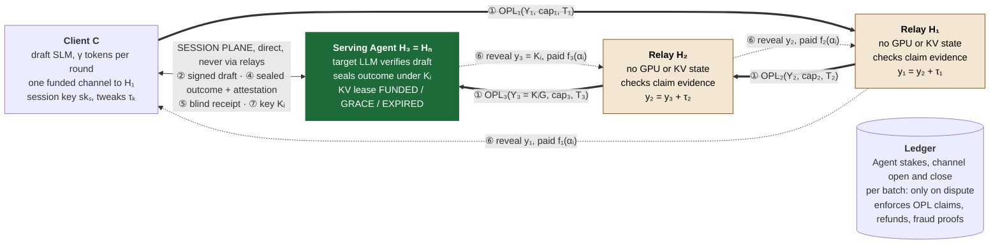

**(b) One round for batch $i$, including the failure branch.**

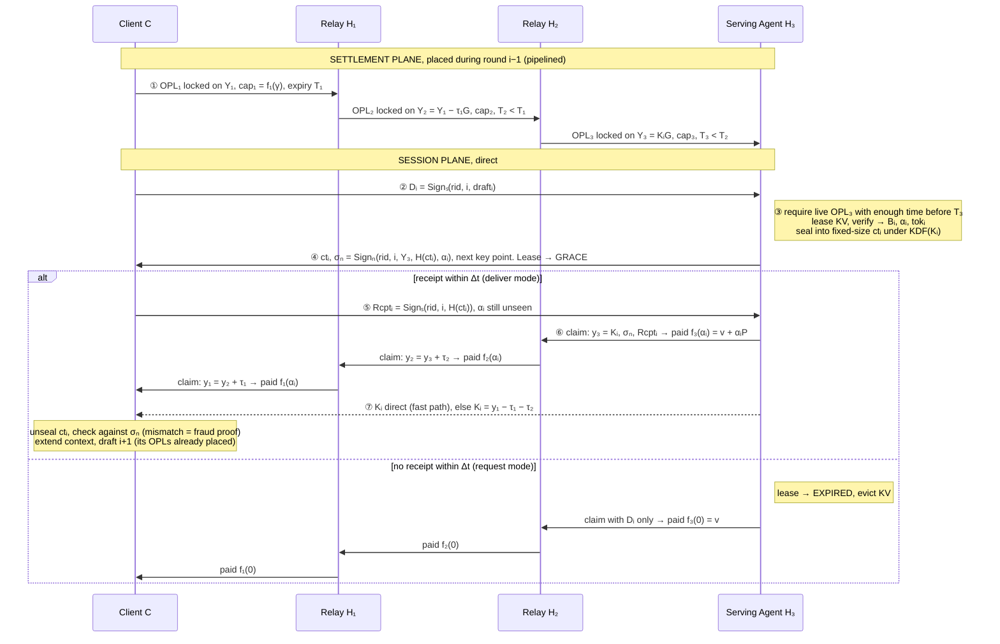

**Figure 1: Overview of SpecRoute** on a route $C \to H_1 \to H_2 \to H_3$, for one draft batch $i$. Panel (a) shows who holds what; panel (b) shows the order of messages.

- **Session plane (top).** It carries the inference exchange directly between the client and the serving Agent.
- **Settlement plane (bottom).** It carries only conditional payments, along the route.

The steps of the round:

- **Step ①.** During round $i{-}1$, the client places an *outcome-priced lock* (OPL) for batch $i$ on every link. Each lock uses a different point $Y_k$, derived from the key point $K_i G$ that the serving Agent committed to in advance.
- **Steps ②–⑤.** The client sends a signed draft. The serving Agent verifies it and returns the outcome sealed under $K_i$, with a signed attestation of the accepted count $\alpha_i$. The client acknowledges the ciphertext without seeing $\alpha_i$.
- **Step ⑥.** The serving Agent claims its lock by revealing $K_i$. Each relay turns the revealed secret into its own by adding its tweak $\tau_k$, and claims $f_k(\alpha_i)$ from its upstream neighbour.
- **Step ⑦.** The client obtains $K_i$, either directly or from $y_1$, and unseals the outcome.
- **Failure path (✗).** If no receipt arrives within the grace period $\Delta t$, the serving Agent evicts the session's KV cache and collects only the request price $f_k(0)$.

The ledger is involved in a batch only if there is a dispute.

### 3.1 Setting

**Entities.**

- **Clients** run a small draft model locally, as in SPECIE. Each holds one funded payment channel with an Agent of its choice, its *entry Agent* $H_1$.
- **Agents** are registered, staked operators with GPU capacity. In a given session an Agent plays one of two roles:
  - the **serving Agent** $H_n$ runs the target model, verifies drafts, and holds the session's KV cache;
  - a **relay** only forwards conditional payments, and holds no GPU or KV state for the session.

  Any Agent can serve some sessions and relay others.
- **Agent-to-Agent channels.** Agents keep dual-funded channels with one another. These form a *channel graph* whose edges carry directional liquidity.
- **The ledger** is a smart-contract blockchain. It registers Agents and their stakes, opens and closes channels, and resolves disputes.

A **route** is $\pi = (C, H_1, \dots, H_n)$. Link $\ell_k$ is the channel from $H_{k-1}$ to $H_k$, with $H_0 = C$. When $n = 1$, SpecRoute reduces to a direct session with a single Agent.

In this section exactly one Agent on the route does work. §4 lifts that restriction: a request may be split across a chain of Agents, each completing part of it and forwarding the rest, and the route becomes a delegation chain. The model here is the special case of §4 in which every Agent but the last does no work.

Figure 2(a) shows these entities on a small channel graph, with one route highlighted.

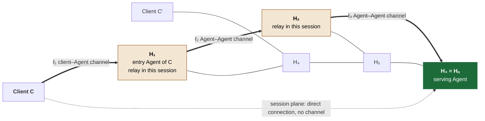

**Figure 2(a): The channel graph.** Thin edges are open channels; thick edges are the route $\pi$ chosen for this session (links $\ell_1$–$\ell_3$). The client has no channel with $H_3$ but reaches it directly over the session plane. The same Agents serve other clients ($C'$), and an Agent that relays here may serve elsewhere.

**Two planes.** SpecRoute separates the traffic that must be routed from the traffic that need not be.

- The **session plane** is a direct, authenticated connection between the client and the serving Agent. It carries drafts, sealed outcomes, receipts, and keys. It never passes through relays, so relays see no prompt or draft, and they add no latency to inference.
- The **settlement plane** carries only per-batch conditional payments along $\pi$.

An Agent is "unreachable" in our setting when the client has no channel with it, not when there is no network path to it. A client with no network path to $H_n$ can tunnel the session plane through $H_1$, end-to-end encrypted to $H_n$ (§6).

**Sessions.** To start a session, the client:

1. picks a serving Agent;
2. finds a path through the channel graph with enough liquidity;
3. runs a handshake with $H_n$ over the session plane, agreeing the price $P$ per accepted token, the batch size $\gamma$, the request price $v$, and the grace period $\Delta t$;
4. gives each relay its per-hop terms (§6).

Throughout, the client authenticates only with a fresh session key $sk_s$, so no Agent other than $H_1$ learns its on-chain identity. Opening a session requires no ledger transaction. The serving Agent keeps SPECIE's admission cap on concurrent sessions and its lease-based KV scheduler unchanged.

Figure 2(b) shows session setup step by step. No step writes to the ledger.

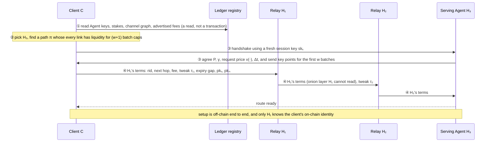

**Figure 2(b): Session setup.** ① The client reads public registry state. ② It selects the serving Agent and a path. ③ It agrees session parameters with $H_3$ directly. ④ It sends each relay its own terms, each encrypted so that only that relay can read them; this is how $\tau_k$ reaches $H_k$ alone.

### 3.2 Goals

SpecRoute provides the following properties to every honest party, whatever the other parties on the route do. §7 states them formally.

- **G1 Outcome-atomic payment.** For each batch, the client pays for the verification outcome only once the key that unseals it has been revealed to it. Every link is charged an amount computed from the same outcome, which the serving Agent attests. If the outcome does not match its attestation, the client holds a fraud proof that slashes the serving Agent's stake.
- **G2 Relay balance security.** An honest relay never loses funds. Every payment it makes downstream is matched by a payment of at least the same amount that it can collect upstream. Its only cost is capital locked for a bounded time.
- **G3 Bounded exposure.**
  - An honest client risks at most one request price per request that goes unanswered, and never pays for an outcome it cannot unseal.
  - An honest serving Agent is paid at least the request price for every verification it performs.
- **G4 Abuse costs at least as much as honest use.**
  - Every verification pass and every unit of KV memory an adversary makes an honest serving Agent spend is paid for at the price an honest client pays.
  - The relay capital an adversarial client can lock is bounded in amount by the capital it locks itself, times the path length, and in time by a deadline the serving Agent sets.
- **G5 Native latency.** Assume that payment latency along the path is below the client's drafting time. Then a round's critical path is the same four direct messages as in a direct SPECIE session.

Figure 3 maps each goal to the party it protects and to the mechanism that delivers it.

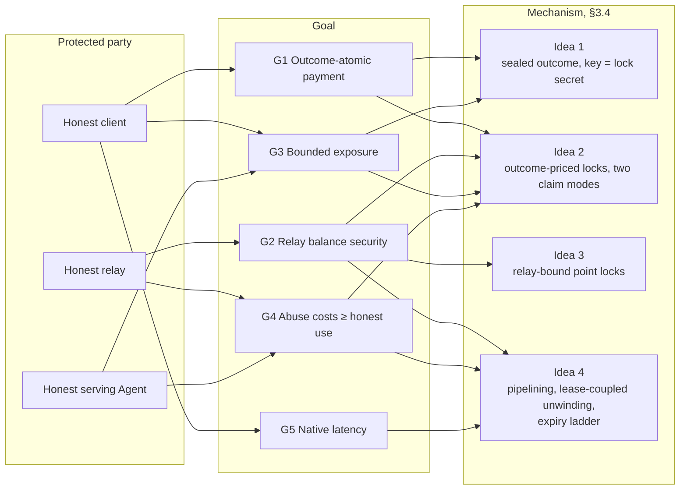

**Figure 3: Goals, who they protect, and what delivers them.** G2 needs three mechanisms. Every hop evaluates the same claim predicate (Idea 2), so a relay can always reuse downstream evidence upstream. Its fee cannot be skipped (Idea 3). The expiry ladder always leaves it time to claim (Idea 4).

### 3.3 Why Routing Speculative Payments Is Hard

Three natural designs each fail in a way that shapes SpecRoute.

**Strawman 1: open a channel to every Agent.** Every new Agent costs two ledger transactions and a minimum deposit. For short inference sessions, which are the common case, this fixed cost dominates the cost of the inference itself. This is the cost SpecRoute exists to remove.

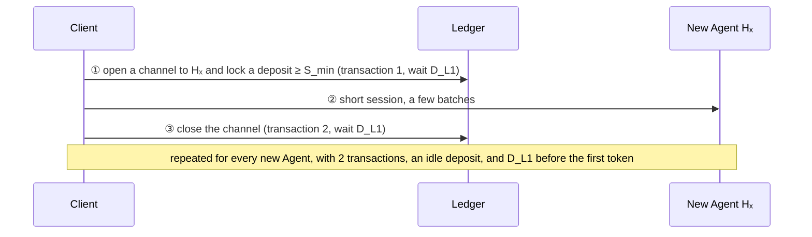

**Figure 4(a): Strawman 1.** A fixed ledger cost for every Agent the client tries.

**Strawman 2: route a Lightning-style HTLC.** Multi-hop hash time-locked contracts route an amount that is fixed *before* the payment is locked. Here the amount $\alpha_i P$ is known only *after* the serving Agent has verified the batch. One workaround is to lock the maximum, $\gamma P$, and refund the difference. That needs a second, reverse payment through every hop for every batch, which costs one path round trip and a second set of locks per batch. A hash lock also has a deeper problem: it releases payment in exchange for a preimage, and a preimage says nothing about whether the client received the verification result it paid for.

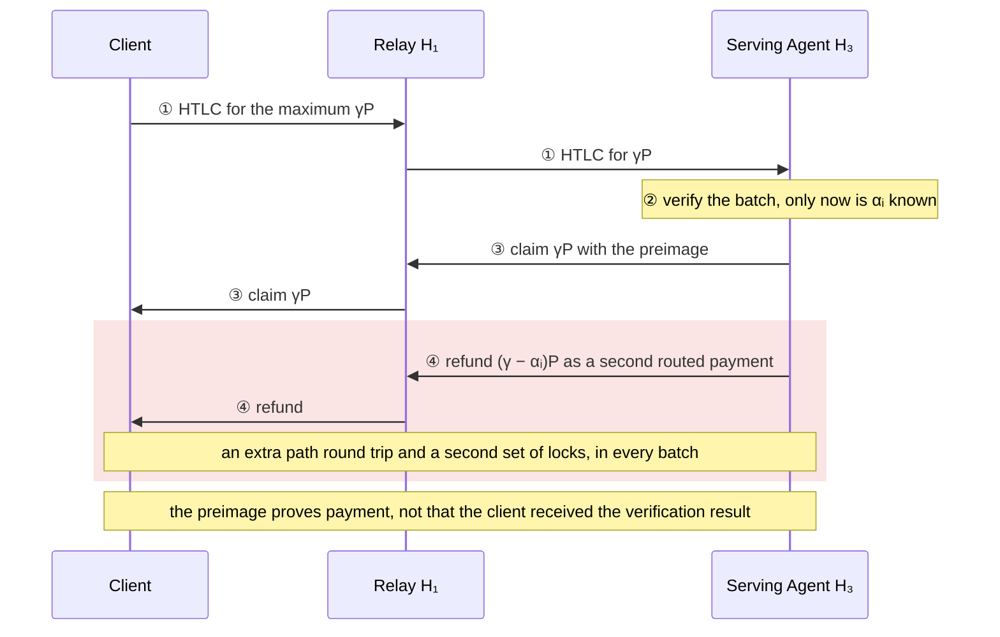

**Figure 4(b): Strawman 2.** A fixed-amount lock forces a refund per batch and does not tie payment to delivery.

**Strawman 3: forward SPECIE's payment envelope hop by hop.** In SPECIE, the client receives the acceptance bitmap $B_i$ in the clear and then pays. Over a direct channel this is safe: a client that takes a bitmap and walks away loses its channel, and must pay the ledger to open a new one. Over a route, sessions cost nothing to open. A client can therefore take one bitmap per session, never pay, and repeat indefinitely. In speculative decoding the bitmap *is* the service, because the client already holds the drafted tokens the bitmap certifies. The same lack of per-session cost lets one deposit back any number of sessions, each holding KV memory at the serving Agent. That is exactly the exhaustion SPECIE's minimum deposit was there to prevent.

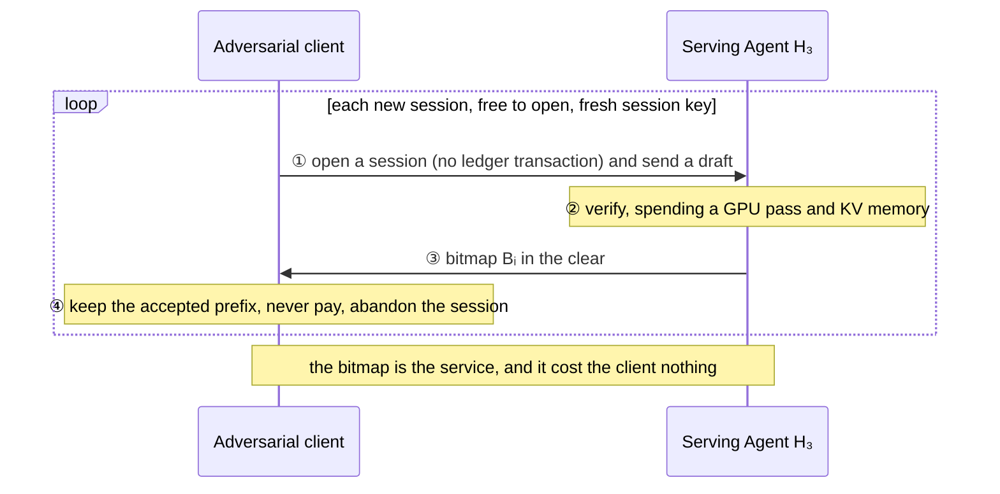

**Figure 4(c): Strawman 3.** Once sessions are free, a plaintext bitmap can be taken without paying, repeatedly.

These failures expose four challenges:

- **C1 Amounts bound late.** The amount is fixed only after the work is done, yet every hop must agree on it without an extra round trip.
- **C2 Fair exchange of information across untrusted intermediaries.** What the client buys is information whose value is realized the moment it is seen. One party delivers it, while the payment passes through several others.
- **C3 Pricing abuse without per-session deposits.** Routing removes the ledger-level cost that deterred free-riding and resource exhaustion in SPECIE.
- **C4 Costs that grow with path length.** Each hop can add latency to every round, and each hop locks its own capital for every batch in flight.

Figure 4(d) traces each challenge back to the strawman that exposes it and forward to the idea that answers it.

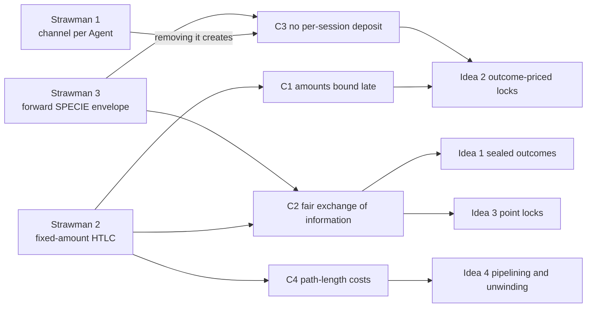

**Figure 4(d): From strawmen to challenges to ideas.**

### 3.4 Key Ideas

**Idea 1: Sealed outcomes whose key is the payment secret (C2).** The serving Agent returns the verification outcome (the bitmap $B_i$ and the correction token) encrypted under a fresh key $K_i$. Every lock on the route is released by a secret from which $K_i$ can be computed. Two consequences follow:

- The client acknowledges the ciphertext before it can read it, so there is nothing it can take before committing to pay.
- The serving Agent cannot collect any payment without revealing $K_i$, so it cannot take payment and withhold delivery. Payment and delivery become the same event, and SPECIE's separate key-withholding dispute is no longer needed.

The price of this is that the client no longer inspects $B_i$ before paying. In SPECIE that inspection could only check the bitmap's *form*, because the client does not hold the target model. SpecRoute keeps that check and makes it binding: an outcome that is inconsistent with the serving Agent's signed attestation is a fraud proof on the ledger.

Figure 5 contrasts the order of exchange in SPECIE and in SpecRoute.

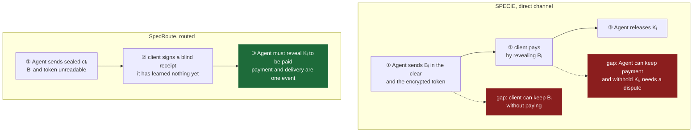

**Figure 5: Sealed outcomes close both gaps of the plaintext exchange.** In SPECIE, one gap is covered by the cost of a new channel and the other by an on-chain dispute. In SpecRoute neither gap exists. The client has nothing readable before it commits, and the Agent has no way to be paid that does not deliver the key.

**Idea 2: Outcome-priced locks (C1, C3).** On each link, each batch is paid through an *outcome-priced lock* (OPL). An OPL is a capped conditional payment whose amount is a public function $f_k$ of the outcome. The same evidence is bound from both ends:

- the serving Agent commits to the outcome in a signed attestation $\sigma_n$, which binds the accepted count $\alpha_i$ to the hash of the ciphertext;
- the client's blind receipt binds the same hash.

Every hop, and the ledger in a dispute, evaluates the same predicate on the same evidence and computes the same $f_k(\alpha_i)$. No hop renegotiates, and no refund travels back. An OPL has two claim modes, and only one can ever be used:

- **Deliver mode** pays $f_k(\alpha_i)$ against the secret, the attestation, and the receipt.
- **Request mode** pays $f_k(0)$ against the client's signed draft request alone. Here $f_k(0)$ is the request price $v$ plus relay fees. $v = v(D_i)$ is a public function of the signed request; for example, it grows with prompt length on a session's first batch. It covers the serving Agent's marginal cost of one verification pass plus the KV memory the session holds until its next batch is due. A session that sends no further draft by then is evicted, so a large request cannot cost the Agent more than it pays.

A client that sends drafts but never acknowledges results therefore pays for exactly the resources it consumed. Holding a KV cache requires sending drafts, and every draft is paid for. This replaces SPECIE's per-channel deposit with a per-request price, and a per-request price still works when sessions are free.

Figure 6(a) gives the claim predicate every hop and the ledger evaluate. Figure 6(b) gives the life cycle of one OPL.

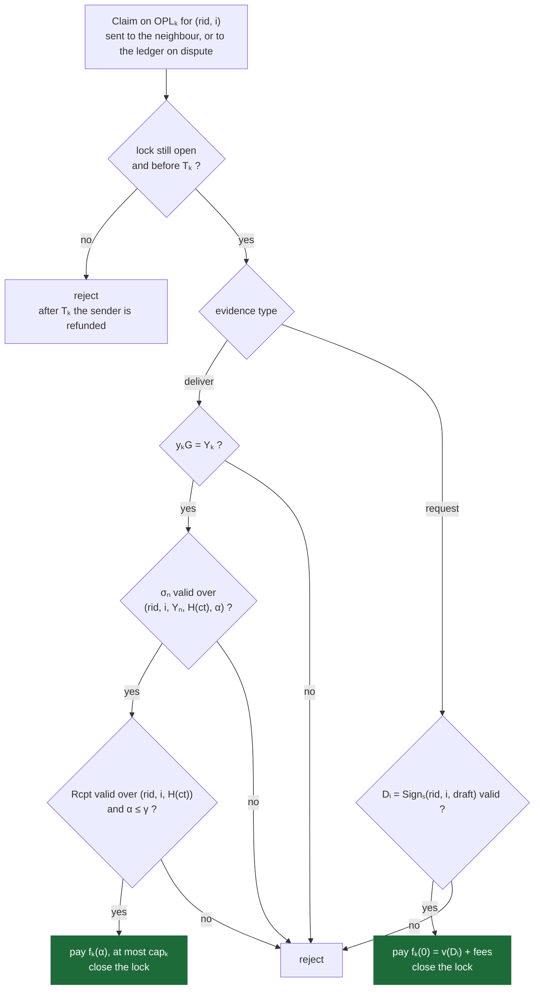

**Figure 6(a): The OPL claim predicate.** The checks are the same at every hop apart from the lock point $Y_k$, so evidence accepted downstream is always accepted upstream. Amounts come only from signed fields, so no hop can compute a different number.

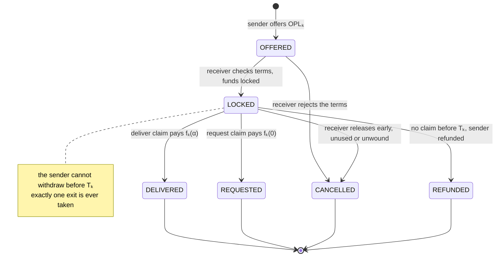

**Figure 6(b): Life cycle of one OPL.** From LOCKED there are four exits, and exactly one is taken. The receiver can always end a lock early, but the sender cannot, which is what lets the serving Agent rely on a lock before it does any work.

**Idea 3: Relay-bound lock secrets (C2, for relays).** SpecRoute does not lock every hop on the same hash. It locks link $\ell_k$ on a point $Y_k = Y_{k+1} + \tau_k G$ in a prime-order group, where:

- $Y_n = K_i G$ is committed in advance by the serving Agent;
- $\tau_k$ is a random tweak that the client gives only to relay $H_k$.

A relay turns the downstream secret into its own by adding $\tau_k$. Each relay's claim is therefore bound to a value only that relay can compute. Two colluding relays cannot skip the honest relay between them and take its fee (the *wormhole* attack on hash-locked routes), and the ledger checks each claim with one scalar multiplication. We use point locks for this binding, not for route privacy: relays verify endpoint-signed evidence and can therefore link the hops of a route (§5).

Figure 7(a) shows how the lock points are built and how the secret travels back. Figure 7(b) shows why the tweaks stop a wormhole.

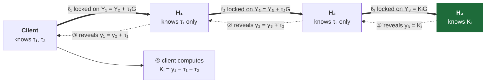

**Figure 7(a): Point locks.** Thick arrows are locks, placed forward; dotted arrows are secrets, revealed backward. Each relay adds only its own tweak. The client, which knows every tweak, recovers $K_i$ from $y_1$.

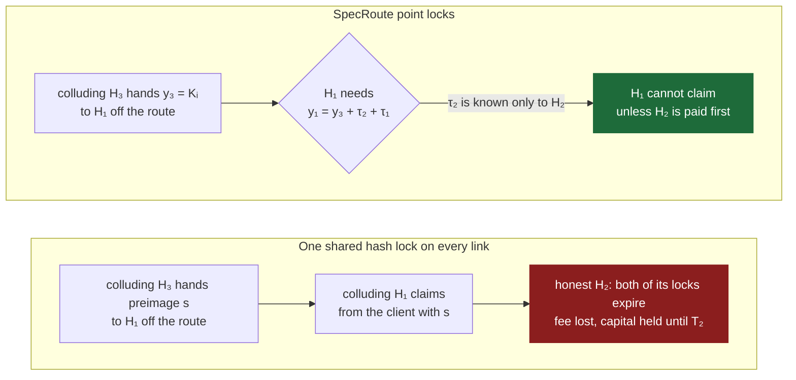

**Figure 7(b): The wormhole attack, with and without tweaks.** With a shared hash, two colluding Agents can skip the honest relay between them and keep its fee. With point locks, the upstream colluder needs the skipped relay's tweak, and the only way to obtain it is to let that relay claim.

**Idea 4: Pipelined locks and lease-coupled unwinding (C4).** This idea addresses latency and collateral separately.

- **Latency.** Each response from the serving Agent includes the key point for the next batch. The client can therefore place batch $i$'s locks during round $i{-}1$, while it is still drafting. Locks travel in parallel with inference rather than ahead of it, and each round keeps SPECIE's four direct messages on its critical path.
- **Collateral.** The serving Agent ties the resolution of each lock to the lease state machine SPECIE already runs for its KV cache. When a session's lease expires, the Agent collects the request price for the outstanding batch and cancels unused pre-placed locks, so the route clears at once. A client therefore cannot keep relay capital locked for longer than a deadline the serving Agent sets.

Only an *Agent* that stops responding can hold capital until the ledger expiries $T_1 > \dots > T_n$. The gaps between these expiries are set by the ledger's finality bound $D_{L1}$, which is seconds on the fast-finality ledger our prototype uses. §8 shows that locked collateral grows linearly with path length for honest traffic and quadratically under stalling, and quantifies both.

Figure 8(a) shows the pipelining that keeps locks off the critical path. Figure 8(b) shows how the serving Agent's lease drives lock resolution.

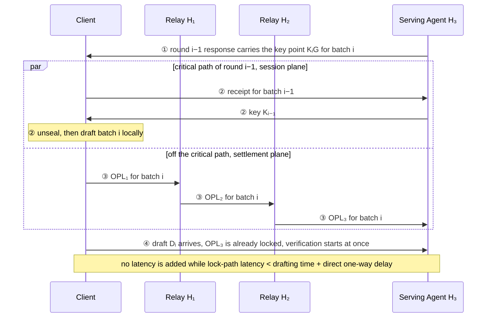

**Figure 8(a): Lock pipelining.** ① The key point for batch $i$ arrives one round early. ② The round $i{-}1$ exchange and drafting run on the session plane while ③ the locks for batch $i$ travel along the route. ④ When the draft arrives, its lock is waiting.

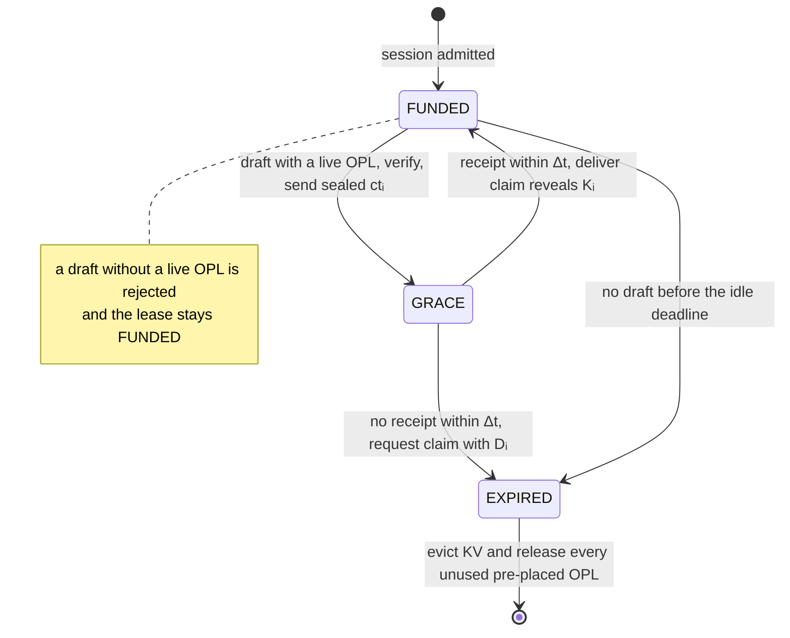

**Figure 8(b): Lease-coupled unwinding at the serving Agent.** SPECIE's lease states now also resolve locks. Every path into EXPIRED settles or releases all of the session's locks, so a non-paying client cannot hold relay capital past $\Delta t$ or the idle deadline.

### 3.5 One Round, End to End

We follow batch $i$ through Figure 1.

- **① Lock (during round $i{-}1$).** The client receives the key point $K_i G$ for batch $i$. It computes the points $Y_k$ and offers $\mathrm{OPL}_1$ to $H_1$, with cap $f_1(\gamma)$ and expiry $T_1$. Each relay checks its terms before forwarding $\mathrm{OPL}_{k+1}$:
  - its fee;
  - that its tweak is consistent, i.e. $Y_k = Y_{k+1} + \tau_k G$;
  - that the expiry gap is at least $D_{L1}$ plus a margin;
  - that the cap covers the downstream cap plus its fee.

  Once offered, a lock cannot be withdrawn by its sender before its expiry; only the receiver can release it early. The client never places two locks for the same $(\mathit{rid}, i)$; a lock that is replaced gets a fresh identifier. The serving Agent accepts a draft only if its incoming lock is in place and has enough time left before $T_n$ to settle on the ledger.
- **② Draft.** The client drafts $\gamma$ tokens and sends the signed request $D_i = \mathrm{Sign}_{s}(\mathit{rid}, i, \mathit{draft}_i)$ to $H_n$.
- **③ Verify and seal.** $H_n$ leases KV blocks for the batch. It runs one forward pass, which yields the bitmap $B_i$, the accepted count $\alpha_i$, and the correction token. It encrypts $B_i$ and the correction token under a key derived from $K_i$, padded to a fixed size so that the ciphertext's length does not reveal $\alpha_i$. Verification is a single forward pass over all $\gamma$ tokens, so the response's timing does not reveal $\alpha_i$ either.
- **④ Attest.** $H_n$ returns three things: the ciphertext $ct_i$; the attestation $\sigma_n = \mathrm{Sign}_{n}(\mathit{rid}, i, Y_n, H(ct_i), \alpha_i)$; and the key point for batch $i{+}w$. The lease enters GRACE.
- **⑤ Blind receipt.** The client returns $\mathrm{Rcpt}_i = \mathrm{Sign}_{s}(\mathit{rid}, i, H(ct_i))$. Up to this point it has learned nothing about $\alpha_i$.
- **⑥ Claim.** $H_n$ claims $\mathrm{OPL}_n$ in deliver mode. It reveals $y_n = K_i$ together with $\sigma_n$ and $\mathrm{Rcpt}_i$, and receives $f_n(\alpha_i) = v + \alpha_i P$. Each relay $H_k$ checks the same evidence, computes $y_k = y_{k+1} + \tau_k$, and claims $f_k(\alpha_i)$ from $H_{k-1}$. The last claim is $H_1$'s claim on the client. Each claim is an off-chain update between neighbours; the ledger sees it only if a neighbour stops cooperating.
- **⑦ Unseal.** $H_n$ also sends $K_i$ directly to the client, as a fast path. The client can instead compute $K_i = y_1 - \sum_k \tau_k$ from the secret $H_1$ reveals when it claims, so it never pays without being able to decrypt. The client then:
  1. decrypts $ct_i$;
  2. checks the outcome against $\sigma_n$ (a mismatch is a fraud proof);
  3. extends its context with the accepted prefix and the correction token;
  4. drafts batch $i{+}1$, whose locks are already in place.

**When things go wrong.**

- **The client never acknowledges.** If no receipt arrives within $\Delta t$, $H_n$'s lease expires. $H_n$ evicts the session's KV blocks as in SPECIE and claims request mode with $D_i$, and the relays pass that claim upstream.
- **The serving Agent never answers.** The client stops drafting, having lost at most $f_1(0)$.
- **Any party goes silent.** Its neighbour settles on the ledger before the relevant expiry. The expiry ladder guarantees that an honest relay that has paid downstream can always collect upstream (§7).

Figure 9(a) gives the worst case the expiry ladder is designed for. Figure 9(b) summarizes each failure and what it costs.

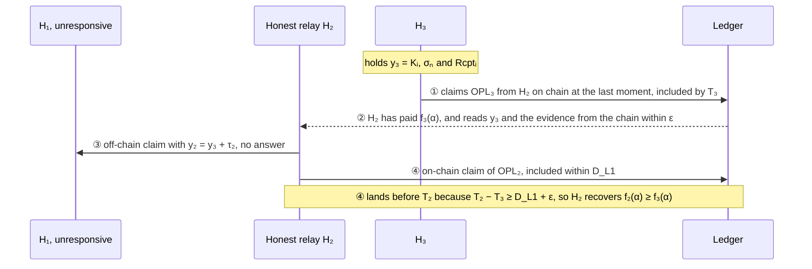

**Figure 9(a): Why an honest relay never loses funds.** Even if the downstream Agent claims as late as it can and the upstream Agent is silent, the gap between expiries leaves the relay enough ledger time to recover what it paid. The argument depends on ledger timing only, never on peer timing.

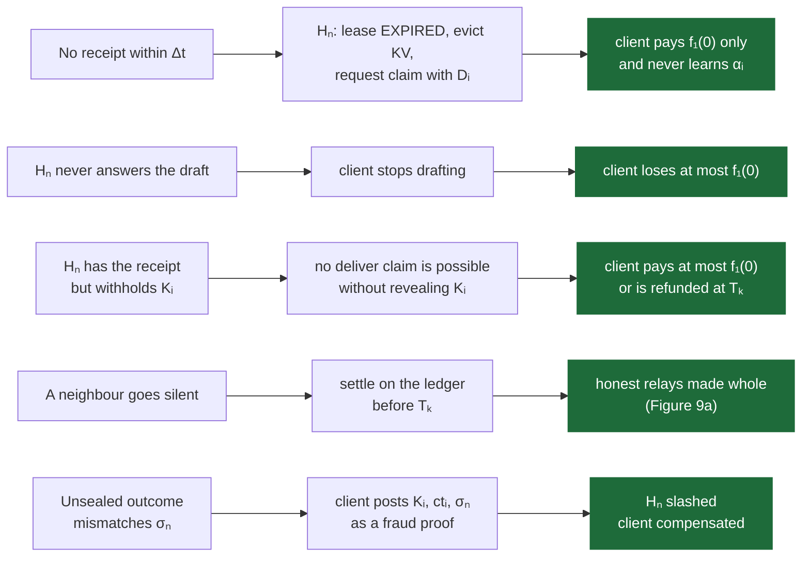

**Figure 9(b): Failures and their worst-case cost.** In every row the honest party's loss is at most the request price, or it is compensated in full.

### 3.6 Assumptions and Scope

SpecRoute relies on standard assumptions, detailed in §5:

- **Cryptography.** Existentially unforgeable signatures, collision-resistant hashing, hardness of discrete logarithms in the lock group $\mathbb{G}$, and authenticated encryption.
- **Ledger.** The ledger is safe, executes contracts as specified, and includes any party's transaction within a known bound $D_{L1}$.
- **Network.** Peer-to-peer messages may be delayed arbitrarily. None of SpecRoute's safety properties depend on their timing; only liveness does.
- **Monitoring.** As in any payment-channel network, each honest party checks the ledger at least once per expiry gap, either directly or through a watchtower.
- **Adversary.** It may corrupt any set of clients and Agents and make them deviate arbitrarily. It cannot corrupt the ledger.
- **Stake.** A client detects a mismatched outcome as soon as it unseals it, and it cannot draft the next batch before doing so. A serving Agent can therefore overcharge each concurrent session at most once before being caught. Its stake is required to cover $N_{\max}$ such overcharges, one per concurrent session it admits.

We also state what SpecRoute does *not* provide, so that §3.2 is not overread:

- **Correctness of inference.** SpecRoute guarantees that the client pays for exactly the outcome the serving Agent attested and that the client can decrypt. It does not guarantee that the target model produced that outcome. An Agent that returns a well-formed but wrong outcome is deterred economically, as in SPECIE. This question is orthogonal to routing: a proof of inference bound into $\sigma_n$ would compose with SpecRoute unchanged.
- **Confidentiality from the serving Agent.** $H_n$ sees the prompt and drafts, as in any inference service. Relays see neither.
- **Route privacy.** Relays learn $\alpha_i$ when they check a claim, and they can link the hops of one route through the endpoint signatures. SpecRoute hides the client's on-chain identity from every Agent except $H_1$. It does not hide the fact that a route exists.
- **Prevention of jamming by a stalling Agent.** An Agent that accepts a lock and then goes silent holds the capital upstream of it until the ledger expiries. The same is true of every network of hash- or point-time-locked contracts. SpecRoute bounds this rather than preventing it. A stall earns the staller nothing, is visible to its neighbour, and holds capital for seconds on a fast-finality ledger. §8 quantifies the worst case.
- **Network-level denial of service** such as link flooding. This is an infrastructure concern, not a protocol one.
- **Work split across several Agents.** This section assumes one serving Agent per session. §4 treats requests that a chain of Agents completes together, and states that extension's own assumptions and limits.

Figure 10 summarizes what SpecRoute relies on, what it does not rely on, and how strong each guarantee is.

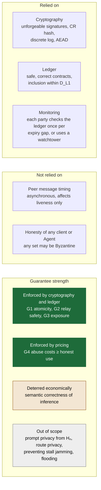

**Figure 10: Assumptions and guarantee strength.** Every safety property rests only on the three assumptions in the top row. Correctness of inference is the one property left to economic deterrence, and it is orthogonal to routing.

---

## 4 Delegated Multi-Agent Tasks

In §3 exactly one Agent does the work of a session, and every other Agent on the route only forwards payments. Many requests do not fit one Agent. An agentic task such as "read these files, write the code, test it, then write the report" has several steps, and the Agent that receives it may lack a tool, a model, or the capacity for some of them. That Agent then does the steps it can and *forwards the rest* to another Agent, which may forward again. One request is therefore completed by a chain of Agents, and each must be paid its fair share of the work.

Two attacks follow from this, and they shape the design:

- **Bad work.** An Agent on the chain does its part wrongly, or not at all, and still claims payment. Because later Agents build on its output, the damage spreads down the chain, and without care no one can tell afterwards whose fault it was.
- **Drop.** An Agent accepts the task, then neither works on it nor forwards it. The request stalls, and without care each Agent can blame its neighbour.

This section extends SpecRoute with four mechanisms. A **work log** of signed, hash-chained records, summarized by a Merkle root, records who did what on which input. **Sealed hand-offs with custody acknowledgments** record who held the task at every moment. **Delegation-chain payment** pays each Agent its share from its own record. **Local blame** turns a failed check on one segment into a conviction of that segment's author alone, followed by a redo from the last good state. §4.1 gives the setting, §4.2 the threats and goals, §4.3 the mechanisms, §4.4 one task end to end, §4.5 the security argument, and §4.6 the assumptions and limits.

**(a) Architecture: the delegation chain is also the payment route.**

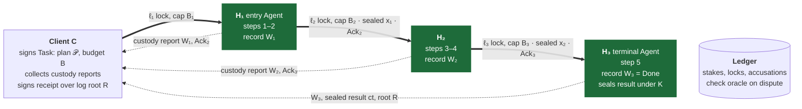

**(b) One task, delegated twice.**

```mermaid
sequenceDiagram
    participant C as Client C
    participant H1 as Agent H₁
    participant H2 as Agent H₂
    participant H3 as Agent H₃
    C->>H1: ① Task = Signₛ(tid, H(x₀), 𝒫, B, …) and lock ℓ₁
    Note over H1: ② steps 1–2 on x₀ → x₁, record W₁
    H1->>H2: ③ lock ℓ₂, W₁, sealed x₁
    H2->>H1: ③ Ack₂ (blind), then H₁ reveals the hand-off key
    H1-->>C: custody report W₁, Ack₂
    Note over H2: ④ steps 3–4 on x₁ → x₂, record W₂
    H2->>H3: ⑤ lock ℓ₃, W₂, sealed x₂, then Ack₃ and key
    H2-->>C: custody report W₂, Ack₃
    Note over H3: ⑥ step 5 on x₂ → result, seal under K, record W₃ = Done
    H3->>C: ⑦ ct, W₃, log root R
    C->>H3: ⑧ Rcpt = Signₛ(tid, R, H(ct)), result still unseen
    H3->>H2: ⑨ claim ℓ₃: open K, τ₃ → paid c₃
    H2->>H1: claim ℓ₂: open K, τ₂, τ₃ → paid c₂ + c₃
    H1->>C: claim ℓ₁: open K, τ₁, τ₂, τ₃ → paid c₁ + c₂ + c₃
    Note over C: ⑩ unseal ct with K. Within T_disp it may accuse any segment (§4.3, M5)
```

**Figure 11: Overview of delegated tasks** on a chain $C \to H_1 \to H_2 \to H_3$. Panel (a) shows who holds what. Panel (b) shows the order of messages.

- **Steps ①–⑥.** Each Agent does a contiguous range of the plan's steps, writes a signed record of its segment, and hands the remaining task to the next Agent. Each hand-off comes with a payment lock.
- **Custody reports.** At every hand-off, the Agent handing off sends its record and its successor's acknowledgment directly to the client. The client therefore knows who holds the task at every moment.
- **Steps ⑦–⑨.** These reuse §3's sealed delivery and blind receipt. Payment flows back along the chain, and each Agent receives the downstream total plus its own share.
- **Step ⑩.** After delivery, a dispute window $T^{\mathrm{disp}}$ remains open, during which any segment can be checked and its author convicted.

### 4.1 Setting

**Task.** The client signs a task descriptor

$$\mathsf{Task} = \mathrm{Sign}_s\big(\mathit{tid},\ H(x_0),\ \mathcal{P},\ B,\ n_{\max},\ \phi_{\max},\ T^{\mathrm{task}},\ T^{\mathrm{disp}}\big),$$

where:

- $x_0$ is the input (prompt, files, context);
- $\mathcal{P} = (s_1, \dots, s_m)$ is the **plan**, an ordered list of steps. Each step $s$ names its specification, its price $p_s$, and its check class $\kappa_s$ (defined below);
- $B \ge \sum_s p_s + n_{\max}\phi_{\max}$ is the budget;
- $n_{\max}$ bounds the length of the chain, and $\phi_{\max}$ bounds the fee one Agent may add for forwarding;
- $T^{\mathrm{task}}$ is the completion deadline, and $T^{\mathrm{disp}}$ the length of the dispute window after delivery.

**Delegation chain.** The chain is $H_1, \dots, H_e$ with $e \le n_{\max}$. Each Agent chooses its own successor among its channel neighbours, so the chain is not known in advance. This differs from §3, where the client chooses the whole route at the start. $H_1$ is the client's entry Agent, and the payment links are $\ell_j = (H_{j-1} \to H_j)$ with $H_0 = C$, as in §3.1.

**Segments.**

- Agent $H_j$ completes a contiguous range of steps $[a_j, b_j]$, starting from state $x_{j-1}$ and producing state $x_j$, with $a_1 = 1$ and $a_{j+1} = b_j + 1$. A range may be empty, in which case $H_j$ only forwards, exactly like a relay in §3.
- The chain ends at a **terminal** Agent $H_e$, which either completes the plan ($b_e = m$, record kind Done) or returns the partial state to the client (record kind Ret, §4.3).
- The state $x_j$ holds everything needed to continue: the outputs of completed steps and the working context.
- The **transcript** $\mathit{tr}_j$ records every source of nondeterminism in the segment: model identifiers (weight hashes), sampling seeds, and tool calls with their responses. Seeds are fixed by the task, as $H(\mathit{tid}, s)$ for step $s$, so an Agent cannot choose them.

**Checks.** Every step declares a check class, and the check of a segment is the conjunction of the checks of its steps:

$$\mathsf{Chk}(W_j) = \bigwedge_{s \in [a_j, b_j]} \mathsf{Chk}_s\big(x_{\mathrm{in}}, x_{\mathrm{out}}, \mathit{tr}_j\big) \in \{\mathsf{ok}, \mathsf{bad}\}.$$

- **Predicate steps** carry a public verifier $V_s(x_{\mathrm{in}}, x_{\mathrm{out}})$: tests pass, output parses against a schema, a proof verifies, a hash matches. Anyone can run it, and the ledger can run a cheap one itself.
- **Replay steps** are deterministic given $(x_{\mathrm{in}}, \mathit{tr})$. A checker re-executes the step and compares output hashes. This requires bit-reproducible inference (fixed precision and batch-invariant kernels) and tool responses that are authenticated, for example signed by the tool's provider. An unauthenticated tool response in a transcript is the Agent's own assertion, so a step that depends on one must use a predicate check instead.
- A step that fits neither class cannot be blamed on anyone. §4.6 states what that costs.

Replay checks are too expensive for a contract, so disputes call a **check oracle**. It can be instantiated as a committee of $k$ Agents that the ledger samples by stake using its own randomness (sound if a majority of the sampled committee is honest), as a TEE attestation, or as a proof of inference. The analysis treats the oracle abstractly and assumes it is sound (§4.6). This is the only trust assumption §4 adds to §3.6.

**Stake.** An Agent that holds custody of a task (§4.3, M3) reserves stake of at least $B + \pi_{\mathrm{drop}}$ for it until the dispute window closes. As in §3.6, its registered stake therefore bounds how many tasks it may hold at once. Acknowledging more tasks than its stake covers is itself provable from its signed acknowledgments and is slashed.

### 4.2 Threats and Goals

The adversary is as in §3.6: it may corrupt any set of clients and Agents, and they may collude. Beyond the two attacks named above, a chain of working Agents invites seven others. Figure 12 summarizes all nine.

- **A1 Bad work.** An Agent outputs a wrong or incomplete segment, possibly a well-formed one, and claims its share.
- **A2 Drop.** An Agent acknowledges the task and then neither works nor forwards it.
- **A3 Overclaiming.** An Agent claims steps it did not do, or a fee above the cap.
- **A4 Tampering and credit theft.** A downstream Agent alters, deletes, or reorders upstream records, or claims an upstream Agent's work as its own.
- **A5 Framing.** An Agent claims it received a different input from its predecessor than it did, to shift blame for its own bad output.
- **A6 Skipping a worker.** Two colluders on either side of an honest Agent settle around it so that it is never paid (the wormhole of §3.4, now costing the skipped Agent its work and not only a fee). The client may be one of the colluders.
- **A7 Withholding.** After the client has receipted, the terminal Agent never reveals the result key, or an intermediate Agent that has been paid by its successor never claims from its predecessor, so upstream Agents are never paid.
- **A8 False accusation.** The client, or an Agent, accuses an honest segment in order to delay payment or impose the cost of a check.
- **A9 Sybil padding.** An Agent forwards the task through Agents it controls, each of which adds a fee for doing nothing.

The goals hold for every honest party, whatever the others do:

- **D1 Fair share.** Every honest Agent whose segment passes its check is paid exactly its share $c_j = \sum_{s \in [a_j, b_j]} p_s + \phi_j$, by the payment chain or, if a convicted Agent blocked that, from the convicted Agent's stake. It never pays downstream more than it collects upstream (§3.2 G2).
- **D2 Exact blame for bad work.** If a segment fails its check, its author can be convicted, and only its author. No honest Agent can be convicted, and no segment that passes its check can be blamed on anyone.
- **D3 Exact blame for drops.** If a task stalls, the ledger identifies the Agent that held custody without discharging it. An honest Agent can always discharge within the ledger response window, whatever the network does.
- **D4 Recovery without rework.** The work of honest Agents before a faulty segment is kept. The faulty segment and the segments after it are redone from the last good state, funded by the convicted Agent's stake.
- **D5 Bounded client exposure.** The client pays at most $B$, and only for a result, final or partial, that it can decrypt. It is compensated from stake for any segment later shown to be bad.

```mermaid
flowchart LR
    subgraph ATT["Attack"]
        A1["A1 bad work"]
        A2["A2 drop"]
        A3["A3 overclaiming"]
        A4["A4 tampering, credit theft"]
        A5["A5 framing a predecessor"]
        A6["A6 skipping a worker"]
        A7["A7 withholding key or claim"]
        A8["A8 false accusation"]
        A9["A9 sybil padding"]
    end
    subgraph MECH["Mechanism, §4.3"]
        M1["M1 work log<br/>signed hash chain + Merkle root"]
        M2["M2 sealed hand-off<br/>blind custody Ack"]
        M3["M3 custody deadlines<br/>accusation that walks the chain"]
        M4["M4 chain payment<br/>shares from records, self-chosen tweaks"]
        M5["M5 local blame<br/>check oracle, bond, redo"]
    end
    A1 --> M5
    A1 --> M1
    A2 --> M3
    A2 --> M2
    A3 --> M4
    A3 --> M5
    A4 --> M1
    A5 --> M2
    A6 --> M4
    A7 --> M3
    A8 --> M5
    A9 --> M4
```

**Figure 12: Attacks on delegated tasks and the mechanisms that stop them.** The two attacks the setting is built around, A1 and A2, each need two mechanisms: one that records the evidence and one that acts on it.

### 4.3 Mechanisms

**M1: The work log (A1, A4).** Every Agent $H_j$ writes one signed record for its segment:

$$W_j = \mathrm{Sign}_j\big(\mathit{tid},\ j,\ h_{j-1},\ [a_j, b_j],\ H(x_{j-1}),\ H(x_j),\ H(\mathit{tr}_j),\ T_j,\ \phi_j,\ \mathit{kind}_j\big),$$

where:

- $h_{j-1} = H(W_{j-1})$ links the record to its predecessor, with $h_0 = H(\mathsf{Task})$;
- $T_j = \tau_j G$ commits to a payment tweak $\tau_j$ that $H_j$ chooses itself and keeps secret (M4);
- $\mathit{kind}_j$ is one of:
  - $\mathsf{Fwd}(pk_{j+1}, H(ct^{h}_j), H(k_j))$: the task was handed to $H_{j+1}$ under the sealed state $ct^h_j$, whose key is $k_j$ (M2);
  - $\mathsf{Done}(Y = KG, H(ct))$: the plan is complete, and the result is sealed as $ct$ under key $K$;
  - $\mathsf{Ret}(Y = KG, H(ct))$: the terminal Agent returns the partial state $x_j$, sealed as $ct$, to the client.

The log $L = (W_1, \dots, W_e)$ is **valid** if:

1. each record links to its predecessor, starting from $H(\mathsf{Task})$;
2. the ranges are contiguous from step 1;
3. each record's input hash equals the previous record's output hash, and $W_1$'s input hash equals $H(x_0)$;
4. only the last record is terminal;
5. $e \le n_{\max}$ and every $\phi_j \le \phi_{\max}$.

The terminal Agent computes the Merkle root $R$ over $W_1, \dots, W_e$. The client recomputes $R$ from the custody reports it has collected and signs its receipt over $R$.

The log combines two structures, and each has its own job:

- **The hash chain fixes the history.** Each record commits to every record before it. No downstream Agent can insert, delete, reorder, or alter an upstream record without breaking a signature or a link. Each record is also pinned by its successor's acknowledgment at the moment of hand-off (M2), so even its own author cannot replace it later: two signed records for the same $(\mathit{tid}, j)$ are an equivocation proof, and the author's stake is slashed.
- **The Merkle root makes disputes small.** To adjudicate segment $j$, the ledger needs only $W_{j-1}$, $W_j$, and two $O(\log e)$ inclusion proofs against the receipted root $R$, not the whole log. The chain alone would already give integrity. The tree is what keeps a dispute's on-chain cost independent of how long the chain was.

```mermaid
flowchart TB
    R["<b>root R</b><br/>signed by the client in Rcpt"]
    N12["H(W₁ ‖ W₂)"]
    N34["H(W₃ ‖ W₄)"]
    R --- N12
    R --- N34
    subgraph CHAIN["Hash chain: each record signed by its author"]
        direction LR
        T0["Task<br/>H(x₀), 𝒫, B"]
        W1["W₁ · H₁<br/>steps 1–2<br/>x₀ → x₁"]
        W2["W₂ · H₂<br/>steps 3–4<br/>x₁ → x₂"]
        W3["W₃ · H₃<br/>no steps, fee only<br/>x₂ → x₂"]
        W4["W₄ · H₄ Done<br/>step 5<br/>x₂ → result"]
        T0 -- "h₀" --> W1
        W1 -- "h₁ = H(W₁)" --> W2
        W2 -- "h₂" --> W3
        W3 -- "h₃" --> W4
    end
    N12 --- W1
    N12 --- W2
    N34 --- W3
    N34 --- W4
    classDef root fill:#1e6b3a,stroke:#1e6b3a,color:#fff
    class R root
```

**Figure 13(a): The work log.** The chain (bottom) records who did which steps, and on which input. The tree (top) commits the whole chain in one root, which the client signs. To accuse $H_2$, a party posts $W_1$, $W_2$, and their inclusion proofs. $H_3$ did no steps and forwarded for its fee, as a relay in §3 does.

**M2: Sealed hand-offs with blind custody acknowledgments (A2, A5).** To hand off, $H_j$:

1. offers the lock on $\ell_{j+1}$ (M4);
2. sends $W_j$ and the sealed state $ct^h_j = \mathrm{Enc}_{k_j}(x_j, \text{remaining plan})$.

$H_{j+1}$ checks that the lock is LOCKED with acceptable terms (Figure 6(b)) and that $W_j$ extends the chain it was offered. It then returns a **custody acknowledgment** over $W_j$, still without being able to read $x_j$:

$$\mathrm{Ack}_{j+1} = \mathrm{Sign}_{j+1}\big(\mathit{tid},\ j{+}1,\ H(W_j),\ \delta_{j+1}\big),$$

where $\delta_{j+1}$ is its custody deadline. $H_j$ then reveals $k_j$, and sends $(W_j, \mathrm{Ack}_{j+1})$ to the client as a custody report.

This is Idea 1 applied between Agents. $H_{j+1}$ commits to *exactly which* input it received, by hash, before it can read the input. It therefore cannot later claim to have received something else (A5). Because it cannot read the state before acknowledging, it also cannot take the state and deny having received it. If $H_j$ never reveals $k_j$, $H_{j+1}$ posts a key demand on the ledger. $H_j$ must then post $k_j$, which the ledger checks against $H(k_j)$ in $W_j$, within $\Delta_{\mathrm{resp}}$, or be convicted of a drop.

**M3: Custody, discharge, and drop accusations (A2, A7).** Custody passes with each acknowledgment. By its deadline $\delta_j$, the custodian $H_j$ must be able to show one **discharge**:

- **Forwarded:** $W_j$ of kind Fwd together with $\mathrm{Ack}_{j+1}$, so that custody has passed on.
- **Delivered:** $W_j$ of kind Done or Ret, and the sealed $ct$ sent to the client. After the client's receipt, its custody continues until it has claimed and so revealed $K$ (M4).
- **Challenged:** an accusation against $W_{j-1}$, if $H_j$ finds after unsealing that its input fails its check (M5).

Return is always available. An Agent that cannot find a successor, lacks the capacity, or is running out of time can write a Ret record for the steps it has done and deliver the partial state. **An honest Agent therefore always holds a discharge by its deadline.**

A **drop accusation** is posted on the ledger by anyone holding $\mathrm{Ack}_j$ after $\delta_j$ has passed. This is $H_{j-1}$ or the client, from its custody reports. The contract then opens a response window $\Delta_{\mathrm{resp}} \ge D_{L1} + \varepsilon$:

- If $H_j$ answers with $W_j$ and $\mathrm{Ack}_{j+1}$, the accusation **moves** to $H_{j+1}$ with a new window. Since $\delta_{j+1} < \delta_j$, that Agent's deadline has already passed.
- If $H_j$ answers with a Done, Ret, or Challenged discharge, the accusation is dismissed.
- If $H_j$ does not answer, it is **convicted**. Its stake pays $\pi_{\mathrm{drop}}$ to the accuser, plus compensation for the capital that upstream Agents have locked toward it (§8).

The accusation thus walks down the chain of acknowledgments and stops at the first Agent that cannot show where the task went. Answers go to the ledger, not to peers, so only $D_{L1}$ matters. Network delay cannot get an honest Agent convicted, because §3.6 already assumes that honest parties monitor the ledger once per window.

**A7 follows the same rule.** Once the client has receipted a valid log, anyone may post a **reveal demand** with $\mathrm{Rcpt}$ and the log. Every Agent $H_k$ in the log must then post its tweak $\tau_k$ (checked against $T_k$) within $\Delta_{\mathrm{resp}}$, and the terminal Agent must post $K$ (checked against $Y$). Each value is known only to its owner, so the Agents that fail to post are exactly the ones blocking payment. They are convicted, and their stake pays the shares $c_k$ their silence blocked.

**Deadlines.** Each Agent accepts a hand-off only if:

- its deadline is strictly earlier than its predecessor's, $\delta_{j+1} < \delta_j$, with $\delta_1 \le T^{\mathrm{task}}$;
- the lock expiries form §3's ladder, $T^{\mathrm{exp}}_{j+1} \le T^{\mathrm{exp}}_j - \Delta_L$, where $\Delta_L \ge D_{L1} + \varepsilon$;
- its own lock outlives its deadline by enough for delivery, a reveal demand, and one on-chain claim: $T^{\mathrm{exp}}_{j+1} \ge \delta_{j+1} + \Delta_{\mathrm{rcpt}} + \Delta_{\mathrm{resp}} + D_{L1}$.

Together with $n_{\max}$, these bound the depth of every chain.

```mermaid
stateDiagram-v2
    [*] --> CUSTODY: Agent signs Ackⱼ
    CUSTODY --> FORWARDED: Wⱼ (Fwd) and Ackⱼ₊₁
    CUSTODY --> DELIVERED: Wⱼ (Done or Ret), ct sent
    CUSTODY --> CHALLENGED: accuses Wⱼ₋₁
    CUSTODY --> ACCUSED: δⱼ passes, accuser posts Ackⱼ
    ACCUSED --> FORWARDED: posts Ackⱼ₊₁ within Δ_resp, accusation moves on
    ACCUSED --> DELIVERED: posts Done or Ret within Δ_resp
    ACCUSED --> CONVICTED: no answer within Δ_resp
    DELIVERED --> SETTLED: claim reveals K and τⱼ
    DELIVERED --> CONVICTED: reveal demand unanswered
    FORWARDED --> [*]
    CHALLENGED --> [*]
    SETTLED --> [*]
    CONVICTED --> [*]: stake pays π_drop and blocked shares
    note right of CUSTODY
        Ret is always available,
        so an honest Agent can always leave CUSTODY
    end note
```

**Figure 13(b): Custody life cycle of one Agent.** Every way out of CUSTODY is backed by a signed object that the ledger can check. CONVICTED is reachable only through silence on the ledger, never through slowness of peers.

**M4: Payment along the delegation chain (A3, A6, A9).** When $H_{j-1}$ hands off to $H_j$, it places a lock on $\ell_j$. This is the outcome-priced lock of Idea 2 with a claim predicate over the log:

- **Pinned terms.** The predecessor hash $h_{j-1}$, the position $j$, the cap $B_j = B - \sum_{k<j} c_k$, and the expiry $T^{\mathrm{exp}}_j$.
- **Amount.** $F_j = \sum_{k=j}^{e} c_k$, computed only from signed fields: the plan's step prices and the ranges and fees in the records. So $F_j = c_j + F_{j+1}$.
- **Claim evidence.** All of the following, each checked by the predicate:
  1. a valid log $L$ that extends the pinned $h_{j-1}$ at position $j$ and ends in a Done or Ret record;
  2. openings $K$ and $\tau_j, \dots, \tau_e$ with $KG = Y$ and $\tau_k G = T_k$ for every $k \ge j$;
  3. proof of delivery: either the client's receipt $\mathrm{Rcpt} = \mathrm{Sign}_s(\mathit{tid}, R, H(ct))$, or $ct$ itself, matching the hash in the terminal record.

Figure 14 gives the predicate. Four properties follow:

- **Every hop evaluates the same predicate.** Once $H_{j+1}$ claims $\ell_{j+1}$, $H_j$ has everything it needs to claim $\ell_j$: the same log, the same delivery evidence, the openings $H_{j+1}$ revealed, and its own $\tau_j$. It collects $c_j + F_{j+1} \ge F_{j+1}$. The expiry ladder gives it ledger time to do so, exactly as in Figure 9(a). This is the balance half of D1.
- **Shares come from records, not from claims (A3, A9).** An Agent is paid for the steps its record names, at the plan's prices. Steps it did not do fail their check (M5). A fee above $\phi_{\max}$, or a chain longer than $n_{\max}$, makes the log invalid. Padding the chain with Sybils therefore costs the client at most $n_{\max}\phi_{\max}$, which the budget already contains, and every Sybil must stake as a custodian.
- **No one can skip a worker (A6).** A claim on $\ell_{j-1}$ must open $\tau_j$, and $H_j$ reveals $\tau_j$ only by claiming $\ell_j$, that is, only once it has been paid. In §3 the client chooses the tweaks and knows them all. Here each Agent chooses its own, because the chain is not known in advance, and a side effect is that a colluding *client* cannot help skip a worker either.
- **Payment delivers (D5).** No claim succeeds without opening $K$ and proving that the client holds $ct$, by its receipt or by carrying $ct$ upstream with the claim. $H_1$'s claim on the client therefore always hands the client $K$. A client that never receipts still pays only for what it can decrypt, and a client that receipts but receives no $K$ is protected by the reveal demand (M3).

```mermaid
flowchart TD
    START["Claim on ℓⱼ for tid<br/>to the neighbour, or to the ledger on dispute"] --> OPEN{"lock open<br/>and before Tⱼᵉˣᵖ ?"}
    OPEN -- "no" --> LATE["reject, sender refunded at Tⱼᵉˣᵖ"]
    OPEN -- "yes" --> L1{"log valid, extends the pinned hⱼ₋₁<br/>at position j, ends in Done or Ret,<br/>e ≤ n_max, every φ ≤ φ_max ?"}
    L1 -- "yes" --> L2{"KG = Y and τₖG = Tₖ<br/>for every k ≥ j ?"}
    L2 -- "yes" --> L3{"Rcpt over (tid, R, H(ct)),<br/>or ct itself, matches the terminal record ?"}
    L3 -- "yes" --> PAY["pay Fⱼ = Σₖ≥ⱼ cₖ, at most Bⱼ<br/>close the lock"]
    L1 -- "no" --> BAD["reject"]
    L2 -- "no" --> BAD
    L3 -- "no" --> BAD
    classDef pay fill:#1e6b3a,stroke:#1e6b3a,color:#fff
    class PAY pay
```

**Figure 14: The claim predicate on a delegation chain.** It plays the role of Figure 6(a), with a log in place of one attestation. The checks differ between hops only in $j$, so evidence that pays $H_{j+1}$ also pays $H_j$ once $H_j$ adds its own tweak.

**M5: Local blame and redo (A1, A8).** A party accuses segment $j$ by posting $W_j$, $W_{j-1}$ (or $\mathsf{Task}$ when $j = 1$), and either inclusion proofs against the receipted root $R$ or $\mathrm{Ack}_{j+1}$, together with an accuser bond $b \ge$ the cost of one check. Any party may accuse: the client within $T^{\mathrm{disp}}$ of delivery, or the successor $H_{j+1}$ once it unseals its input.

1. **Data.** $H_j$ must supply $x_{j-1}$, $x_j$, and $\mathit{tr}_j$ within $\Delta_{\mathrm{resp}}$. The hashes in $W_j$ bind these contents, so no one can substitute others. Every Agent must retain its input, output, and transcript until $T^{\mathrm{disp}}$. Its predecessor also holds $x_{j-1}$, and the accuser may supply it. An Agent that cannot produce its own data is convicted.
2. **Check.** The ledger evaluates a predicate step itself, and sends a replay step to the check oracle.
3. **Outcome.**
   - If $\mathsf{Chk}(W_j) = \mathsf{bad}$, $H_j$ is convicted. Its stake refunds the client $F_j$, everything paid from segment $j$ onward, and the accuser's bond is returned.
   - If $\mathsf{Chk}(W_j) = \mathsf{ok}$, the bond goes to $H_j$ (A8).

**Blame is local.** Each segment is checked against *its own committed input*, not against what its input should have been. An Agent that correctly processes a bad input is not guilty, and the Agent that produced the bad input is guilty whatever happened after it. Deciding whether one given Agent cheated therefore takes one check of one segment, with no bisection over the chain, and several faulty segments are convicted independently. What makes this sound is a composition property:

> **Lemma 1 (composition).** If $L$ is a valid log and $\mathsf{Chk}(W_j) = \mathsf{ok}$ for every $j$, then $x_e$ is a correct execution of steps $1, \dots, b_e$ of $\mathcal{P}$ on $x_0$.
>
> *Proof sketch.* Induct on $j$. $W_1$'s input is $x_0$ by validity condition 3. If $x_{j-1}$ is a correct execution of steps $1..b_{j-1}$, then $W_j$'s input hash equals $H(x_{j-1})$, and $\mathsf{Chk}(W_j) = \mathsf{ok}$ means $x_j$ correctly executes steps $a_j..b_j$ on that input. Collision resistance of $H$ rules out a different state with the same hash.

**Corollary.** A wrong final result implies that at least one segment fails its check. Some Agent can therefore always be convicted, and by D2 only one that actually cheated.

**Redo (D4).** Recovery starts from the last good state, $x_{j-1}$, which honest Agents produced and $H_j$ acknowledged. No step before $a_j$ is repeated.

- **Detected mid-chain.** If the accusation comes from $H_{j+1}$ before delivery, $H_{j-1}$ hands off again from $x_{j-1}$ to a fresh successor $H'_j$, with a new lock pinned to the same $h_{j-1}$. Upstream locks pin only the prefix, so the final log $W_1, \dots, W_{j-1}, W'_j, \dots$ satisfies them unchanged. $H_j$ is not in the final log and is paid nothing. Capital that $H_{j-1}$ left locked toward $H_j$ is compensated from $H_j$'s stake.
- **Detected after delivery.** The client has already paid. The refund of $F_j$ funds a new task over steps $a_j, \dots, m$ from $x_{j-1}$, which was produced during the dispute. Agents after $j$ keep their shares, because each did correct work on the input it was given.

```mermaid
sequenceDiagram
    participant C as Client C
    participant H1 as Honest H₁
    participant H2 as Faulty H₂
    participant H3 as Honest H₃
    participant L as Ledger + check oracle
    participant H2b as Fresh Agent H₂′
    Note over H1,H3: W₁: x₀ → x₁ (ok) · W₂: x₁ → x₂ (bad) · W₃: x₂ → x₃ (ok on its input)
    alt detected mid-chain by the successor
        H3->>L: ① accuse W₂ with W₁, W₂, Ack₃, bond b
        L->>H2: ② supply x₁, x₂, tr₂ within Δ_resp
        L->>L: ③ Chk(W₂) = bad → convict H₂
        H1->>H2b: ④ hand off again from x₁, new lock pinned to h₁
        Note over H1,H2b: final log W₁, W₂′, … · H₂ paid nothing
    else detected by the client after delivery
        C->>L: ① accuse W₂ with inclusion proofs against R, bond b
        L->>H2: ② supply x₁, x₂, tr₂ within Δ_resp
        L->>L: ③ Chk(W₂) = bad → convict H₂
        L->>C: ④ refund F₂ = c₂ + c₃ from H₂'s stake, and x₁
        C->>H2b: ⑤ new task: steps a₂ … m from x₁
        Note over C,H3: H₁ keeps c₁ · H₃ keeps c₃ (correct on its input) · no step before a₂ is redone
    end
```

**Figure 15: Blame and redo.** One check of one segment convicts $H_2$ alone. Recovery restarts from $x_1$, the last state honest Agents produced, so $H_1$'s work is neither repeated nor lost.

### 4.4 One Task, End to End

We follow the task in Figure 11(b).

- **① Open.** The client signs $\mathsf{Task}$ and locks $\ell_1$ with cap $B$. Opening a task needs no ledger transaction, as in §3.1.
- **②–⑥ Work and hand off.** Each Agent runs its steps and writes its record. It then hands off under M2: lock, record, sealed state, acknowledgment, key, and custody report. Each successor checks the lock and the chain before it acknowledges.
- **⑦ Deliver.** The terminal Agent seals the result under $K$, writes a Done record, and sends $ct$, its record, and $R$ to the client.
- **⑧ Receipt.** The client recomputes $R$ from its custody reports and the terminal record, checks validity (M1), and signs $\mathrm{Rcpt}$ without having seen the result.
- **⑨ Claims.** Claims travel back up the chain, each opening one more tweak. The terminal Agent also sends $K$ to the client directly, as the fast path of §3.5.
- **⑩ Dispute window.** The client unseals the result. If it is wrong, the corollary guarantees that some segment fails, and the client accuses it under M5. When $T^{\mathrm{disp}}$ closes, the stake reservations are released.

**When things go wrong.**

- **An Agent drops the task.** The client sees from its custody reports who holds the task and when that deadline passes. It accuses under M3, and the accusation stops at the dropper. The custodian before the dropper hands off again or returns.
- **An Agent cannot finish.** It returns the partial state under a Ret record and is paid for the steps it did. The client may start a new task from that state.
- **Bad work.** Handled by M5, either mid-chain or after delivery.
- **The client never receipts.** Claims carry $ct$ upstream with them, so the client still receives what it pays for.
- **Withheld key or claim.** Handled by the reveal demand of M3.

### 4.5 Security Argument (sketch)

Full proofs belong in §7. Here we give the reason each goal holds.

- **D1.** For balance: every hop evaluates the same predicate on the same evidence, and $F_j = c_j + F_{j+1}$. With the expiry ladder, the argument of Figure 9(a) applies unchanged. For the share itself, the only ways to keep an honest $H_j$ from collecting $c_j$ are:
  - skipping it, which needs $\tau_j$;
  - withholding $K$ or a downstream tweak, which the reveal demand turns into a conviction;
  - blocking the chain, which the drop accusation turns into a conviction.

  Each conviction pays the blocked shares from stake of at least $B$.
- **D2.** A conviction for bad work requires $\mathsf{Chk}(W_j) = \mathsf{bad}$ on a record that $H_j$ itself signed, over inputs bound by hashes that $H_j$ itself signed, which $\mathrm{Ack}_{j+1}$ pins against later replacement. With unforgeable signatures, collision-resistant hashing, and a sound oracle, an honest segment is never convicted. The corollary to Lemma 1 shows that a faulty result always yields one.
- **D3.** Discharges are signed objects that the ledger checks. An honest Agent always holds one, since Ret is always available, and answers within $\Delta_{\mathrm{resp}} \ge D_{L1} + \varepsilon$. A dropper holds none. The strict ordering $\delta_{j+1} < \delta_j$ makes the accusation move forward, never backward, so it stops at exactly one Agent.
- **D4.** Upstream locks pin only the prefix $h_{j-1}$, and $x_{j-1}$ is bound by hash and retained by two parties. A redo therefore extends the same prefix.
- **D5.** The client's total payment is $F_1 \le B$. Every claim opens $K$ and proves delivery. A refund after conviction is drawn from a stake that is reserved per task.

### 4.6 Assumptions and Limits

§4 adds one assumption to §3.6 and leaves the rest unchanged:

- **Sound check oracle.** A checker returns bad exactly when a segment deviates from its steps' specification. This assumption is confined to blame. D2 and D4, and the compensation part of D5, depend on it. Payment safety (the balance half of D1) and drop blame (D3) do not.

Its scope has these limits:

- **Steps that cannot be checked.** An open-ended step such as "write a persuasive summary", with no predicate and no reproducible execution, cannot be blamed on anyone. A plan must declare a check class for every step. A step without one is priced as *unchecked*: the client bears its risk, and the protocol still guarantees D1, D3, and the payment part of D5 for it.
- **Reproducible execution.** Replay checks need bit-reproducible inference and authenticated tool responses. Batch-invariant kernels make the first possible at some throughput cost, which we measure in §9. The second needs provider signatures or an attested TLS session.
- **Fixed plan.** The client fixes the plan. Re-planning can be expressed as a step whose output is the remaining plan, checked by a predicate that enforces the budget and format. We leave richer dynamic decomposition to future work.
- **Confidentiality.** Every Agent on the chain sees the state it works on, just as $H_n$ sees the prompt in §3.6.
- **Collateral and time.** Locks are held for the duration of the task, which may be minutes rather than one batch, and reserved stake is held until $T^{\mathrm{disp}}$. §8 extends the collateral model to delegation chains.

```mermaid
flowchart TB
    subgraph RELY["Relied on, beyond §3.6"]
        direction LR
        A1["Sound check oracle<br/>committee, TEE, or proof of inference"]
        A2["Reproducible replay<br/>batch-invariant inference,<br/>authenticated tool responses"]
    end
    subgraph STRENGTH["Guarantee strength"]
        direction LR
        E1["Cryptography and ledger only<br/>D1 balance, D3 drop blame,<br/>D5 pay only on delivery"]
        E2["Plus the check oracle<br/>D2 exact blame, D4 redo,<br/>D5 refund for bad work"]
        E3["Out of scope<br/>blame for unchecked steps,<br/>state privacy from chain Agents"]
    end
    RELY ~~~ STRENGTH
    classDef strong fill:#1e6b3a,stroke:#1e6b3a,color:#fff
    classDef weak fill:#f3e6d3,stroke:#8a4700,color:#000
    classDef none fill:#eeeeee,stroke:#777,color:#000
    class E1 strong
    class E2 weak
    class E3 none
```

**Figure 16: What delegated tasks rely on.** Payment safety and drop blame need nothing beyond §3's assumptions. Only exact blame for bad work, and the redo and refunds it triggers, rely on the check oracle.
